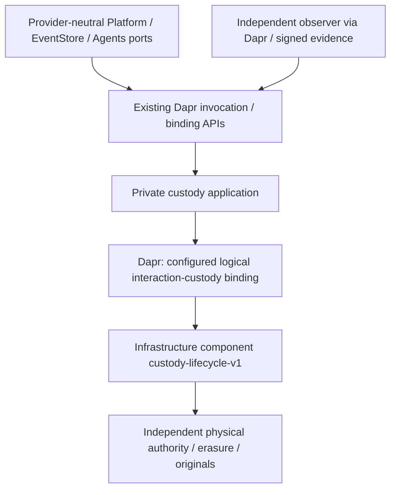

# Architecture Spine — EXT-PROTECTION-1 custody

## Design Paradigm

**Hexagonal custody boundary with a recoverable state machine.** Provider-neutral ports surround separately governed current authority and physical epoch erasure. Actors/restored application state are projections, never physical authority.

AD-16–AD-25 are **ADOPTED** at architecture level following owner approval, qualified by the subsequent explicit Dapr-only instruction. The [decision](../../../../docs/implementation/ext-secrets-1-erasure-authority-decision-2026-10-20.md) and [approval record](../../../../docs/implementation/ext-secrets-1-erasure-authority-2026-10-20/OWNER-APPROVAL.md) define scope. Shared-cut/recoverable publication is the accepted physical criterion; one cross-service native transaction is not claimed. Component/provider feasibility, installation and qualification remain incomplete. No direct native-adapter exception or mandatory cloud dependency is adopted, and no register/status changes here.

AD-26 carries the already accepted history policy into this slice. AD-27/AD-28 recommend its physical enforcement and shared recovery boundaries; their construction remains subject to the precise [owner decisions](../../../../docs/implementation/ext-protection-1-custody-design-2026-10-18.md#remaining-owner-decisions). Interaction pending-erasure tolerance never relaxes history expiry. AWS remains an unaccepted reference profile; no qualifying backend for either domain is established here.

## Inherited Invariants

Parent IDs retain their original meaning, read-only; local decisions start after AD-15.

| Inherited | From Platform initiative spine | Binds here |
| --- | --- | --- |
| AD-1 | Composition ownership | Platform infrastructure; EventStore domain/source behavior. |
| AD-4 / AD-5 | Source/package and exact candidate | Implementation/qualification identity. |
| AD-6 / AD-7 / AD-8 | Admin, executor and environment isolation | New deployment and current enrollment. |
| AD-9 | Dapr infrastructure boundary | All custody application access uses Dapr; no new native exception. A semantic component adds missing guarantees, not a thin wrapper around an exception. |
| AD-10 | Exact run ownership | Later experiments/cleanup. |
| AD-12 | Independent key custody and erasure-safe backups | Separate recovery classes and survivor recovery. |
| AD-15 | Forward-only security state | App rollback cannot roll back authority/key lifecycle. |

## Invariants & Rules

### AD-16 — Dapr semantic custody boundary [ADOPTED, AMENDED]

- **Binds:** provider/component/deployment selection, G1/G3.
- **Prevents:** direct provider coupling, backup-restorable Raft or target-delete loops becoming erasure authority.
- **Rule:** Use a configured provider-neutral Dapr output binding with custody-lifecycle-v1 semantics behind existing ports. Prefer a supported qualifying component; none complete was verified. Concrete fallback bindings.hexalithcustody/v1 is a new unimplemented pluggable component, not a built-in/installed provider. It owns current authority, holds, full manifest, physical intents and exact originals. Native SDKs/resource IDs/credentials live only inside infrastructure component implementation/configuration. AWS epoch/table/object profile remains reference feasibility research, never an app dependency. Shared physical cut plus exact recoverable publication is adopted; no native cross-service transaction claimed. No production binding until Dapr/provider native proof passes.

### AD-17 — Original tenant KEK wrapper inside one erasure gate [ADOPTED, AMENDED]

- **Binds:** wrap/unwrap, target identity, rotation, migration.
- **Prevents:** historical KEKs/ungated wrappers reviving content or KekVersion being reinterpreted.
- **Rule:** Keep one original 32-byte D per interaction and existing AES-GCM tenant K(t,v) wrap C0/AAD/version. Protect K under provider-private R(t). Persist only outer AES-GCM-X(C0) and X encrypted under tenant epoch E(t,g), never bare C0. Closed private envelope v1 binds full original context without changing contract fields. Rewrap only survivors' X to one independently verified successor before deleting E(g). Before B3 require independent actual permanent-deletion evidence for every other predecessor/abandoned/tainted generation receiving X; current source E(g) stays live until B4 and exact successor stays live for survivors, with no selected X path through successor; scheduling/disablement is insufficient. Unknown copy closure blocks arm. No migration from historical ungated copies is inferred.

### AD-18 — Independent current authority and permanent allocation exclusions [ADOPTED, AMENDED]

- **Binds:** creation/reissue, enrollment, actor anchors and restore.
- **Prevents:** restored config/tables/credentials/actors becoming current authority.
- **Rule:** Independently enroll opaque authority/store/profile/incarnation and public trust outside app backups; native resource identities stay inside component configuration/evidence. One conditional tenant head binds complete immutable checkpoint ancestry, permanent original indexes and allocation exclusions by both target and interaction. Alias/version changes cannot reissue a root; unwrap/absence never creates one. Unknown unrecoverable unpublished allocation burns its identity. Fence old grants before replacements and reconcile admitted originals through inherited anchored transitions. Initial AuthorityEnrollmentV1 pins opaque AuthorityId, incarnation, StoreTarget, ProviderProfileId, trust revision/anchor-set and artifact-profile digest. First-release authority replacement/incarnation rollover is unsupported; restored provider stores cannot self-promote and authority loss fails closed until separate architecture/qualification. Total surviving-authority loss/compromise/rollback fails closed, never bootstraps genesis.

### AD-19 — Guard dispatch, protection reserve and custody arm stay distinct [ADOPTED, AMENDED]

- **Binds:** hold/pin/unpin, cancel/consume and physical reservation.
- **Prevents:** ignored effective pins, retroactive cancellation or a replacement cancellation owner.
- **Rule:** Register governance hold before physical pin grant. Consume authenticated immutable guard precedence and exact B0 protection reservation at native custody admission. Earlier effective/unknown pins or unknown ordering block destruction. A later post-dispatch hold cannot acquire a conflicting successful effective pin, even before custody sees B0, and remains restrictive elsewhere. Native head CAS serializes effective pins/unpin/reserve; exact authorized release preserves other pins. EventStore alone owns v23 block/reserve/activation. Missing handoff proof denies; check-then-delete is invalid. No Product disposition changes.

### AD-20 — Shared physical cut with original-only forward recovery [ADOPTED, AMENDED]

- **Binds:** 1–1,000 target manifests, survivors, pending work.
- **Prevents:** partial target erasure, collateral survivor loss or replacement originals after failure.
- **Rule:** Bind exact B0/full sorted vector; CAS-freeze all tenant allocation/copy/content-write/key-acquisition admission B1–B3, drain pre-freeze native intents/producers/holders/writers, verify complete survivor checkpoint and CAS-arm one epoch. B3 atomically adopts successor as currentEpoch; only then resume survivor/new-root admission exclusively under it. Hold/unpin/revocation mutations invalidate stale preparations. No native destination may be E(g) after freeze. One physical cycle per tenant; queue B0 originals unchanged. Invoke the component's admitted physical protocol and retain Unknown until actual permanent cut/independent closure; the reference profile allows seven-plus-day pending erasure without a fixed SLA. Never delete per target. Durable worker alone resumes admitted intents; caller lookup starts no effect. Stale workers cannot publish a head. Admitted stops never become NotStarted. The shared-cut equivalence is adopted under AD-16; its physical proof remains required.

### AD-21 — Actual all-copy closure precedes terminal results [ADOPTED, AMENDED]

- **Binds:** Destroyed/Consumed, restore barrier, observation.
- **Prevents:** schedules/disablement/missing keys/provider summaries being called irreversible.
- **Rule:** B5 needs independently verified final irreversible epoch-deletion evidence for exact E and every decrypting predecessor/abandoned epoch, complete native integrity/trust material, copy/holder closure and successful independent survivor recovery. Provider-specific evidence verification belongs to the component/independent infrastructure observer, exposed as authenticated provider-neutral proof through Dapr. Retain authenticated RestoreBarrierReceiptId and original vector. Vendor assurance and missing-holder termination proof are OA-4, not physical inspection. No fixed completion SLA follows from seven-day scheduling; incomplete evidence remains Unknown.

### AD-22 — Fixed native head transaction selects complete immutable originals [ADOPTED, AMENDED]

- **Binds:** mutation, vectors, original indexes, outcomes/coverage.
- **Prevents:** chunked manifests, forked heads, finite-token replay or regenerated receipt bytes.
- **Rule:** Prewrite/verify full objects' version/hash/retention, then one qualified component-owned conditional transaction updates head and permanent operation/event indexes. Every fact binds prior checkpoint; CAS failure recomputes. Fit actual provider item/action/message limits; never split a manifest into independent target commits. Preserve exact signed/vector bytes and original batch/reservation without TTL. B5 merges into current state, never reinstalls preparation state. NotStarted requires authoritative exact absence without uncertain admission; outage is Unknown. Later coverage uses original target receipts and existing residual protocol, never changes signed membership.

### AD-23 — Preserve ports, accepted policy and trust separation [ADOPTED, AMENDED]

- **Binds:** adapters, runtime integration and compatibility.
- **Prevents:** backend selection weakening source contracts or policy.
- **Rule:** Preserve provider-neutral six operations, original identity/AAD/statuses/anchored transitions, v21/v23 ordering and non-expiring revocable capability. Interaction Destroy delegates to its original complete manifest. Add private batch backend/outer envelope behind unchanged consumer contracts. Preserve timing 300/30/600/86400/604800, Open overlap, host/date and independent approval signer. Occurrence use requires original encryption/write leases, current checks and actual remote completion integration. First release retains actor 1,000-registration/10,000-request hard limits, no automatic archive/shard/eviction. Reserve completion capacity before admission and fail closed before exhaustion; Interaction-feasibility F1 must measure that finite budget. Never drop physical originals/allocation exclusions. Separately encrypted export/partial/key/backup paths need their own accepted closure; Open/unqualified export policy blocks all-copy B5 for affected targets. Export-free branches remain eligible. Other history/qualification obligations remain separate.

### AD-24 — Every copy and holder joins closure before effect [ADOPTED, AMENDED]

- **Binds:** storage/recovery, diagnostics, copies, operators and key-use.
- **Prevents:** late buffers, bare wrappers or alternate key paths reviving content.
- **Rule:** Register actual copy/generation/holder identity/location/owner/lineage/retention/exact outcome before effect. Include source/target/snapshot/cache/workflow/broker/export/partial/backup, DB logs/restores, S3 versions, KMS generations and SDK/TLS/runtime memory. Persist only gated wrappers/encrypted keys. Disable swap/core/hibernation/memory capture; require authenticated completion/zeroing or accepted termination proof. Lease expiry alone is not erasure. Only the infrastructure component's private key-execution boundary has provider key-use permissions; application workers/callers/recovery have no native grants. Include Dapr SDK/sidecar/component UDS/gRPC buffers, delayed delivery, diagnostics and retry layers in holder/copy closure. Durable NativeIntentV1 commits one send, disables SDK/HTTP retries and redirects, and closes only after result persistence plus actual I/O/buffer completion. Never replay send-unknown intents. B3 requires all pre-freeze producer incarnations drained or independently terminated. Taint unknown staging destinations and permanently delete them before arm; an unknown current/adopted destination blocks qualification. Provider eventual consistency/grant revocation or sidecar replacement alone never fences native effects. Direct decrypt/rewrap bypass and policy drift invalidate closure. Unknown copies/holders block B5. Receipt encryption/public trust retention are independent of E under OA-6.

### AD-25 — No infrastructure bypass outside Dapr [ADOPTED]

- **Binds:** this custody feature in Platform, custody application services, EventStore, Agents, observers, configuration and tests.
- **Prevents:** a Dapr facade hiding an application-native SDK, provider connection or hand-built distributed infrastructure saga.
- **Rule:** Application paths use existing Dapr invocation/binding APIs and neutral custody DTOs only. Resolve logical component/service roles from configuration; expose no cloud SDK/package/provider endpoint/resource ID/credential in app contracts or DI. No generic state+crypto+storage calls simulate physical atomicity. Component operations are closed and exact-original authenticated; Duplicate transport invokes recover one value-free original, lookup never sends an effect. Key-bearing unwrap results are ephemeral and never cached/persisted/replayed: one pre-enrolled recipient/transport-incarnation KeyUseLeaseId/DeliveryAttemptId tracks each actual release and buffer. Closed/frozen/erased duplicates return proof/status only; fresh authorized key-use admission may use the same original root. Expose distinct admit/record/recover/verify-transition phases; anchor recovery is separately authorized mutation, never lookup or physical replay. Fresh challenge-bound linearizable read-current never replays a cached signed head. Enforce daprd/component-only UDS access and immutable enrolled Init/re-registration preserving originals/intents/uncertain holders. The pinned pluggable response ceiling is 4 MiB without a verified override: retrieve value-free exact original vectors with bounded authenticated pages, reassemble/hash-verify before public Consumed, never page keys or split manifest consumption. Full input must fit verified supported limits or stop. Verify effective Dapr/component retries, reflection/imports/socket registration, sidecar restart/late I/O and secret-buffer lifetime. Infrastructure component implementation may use provider internals, isolated from app dependencies; generic wrapper/stub/secret delete is never qualification. Parent AD-9 remains intact with no custody exception.

### AD-26 — Separate history units retain their original exclusive expiry [ADOPTED POLICY]

- **Binds:** Parties binding evidence, EventStore source/snapshots and Platform history custody.
- **Prevents:** profile/content erasure destroying retained attribution, or copying/revocation extending it.
- **Rule:** Retain purpose party-actor-history-v1 under party-actor-retention-v1 for exactly 31,536,000 seconds from original binding-effective-at; permit only now < ExpiresAt. Normalize offsets without moving the instant; overflow/unknown scope denies. Profile erasure immediately removes current eligibility and preserves only approved bounded history. Isolate each original unit and every decrypting generation from profile keys, interaction epochs and other deadlines. Snapshots partition duplicated bindings/transitions by original unit. Retry, rotation, rebind, revoke, reprojection and restore never renew predecessor expiry. Parties/EventStore must resolve Q5's establish/rebind/revoke identity and history F1's actor-free successor proof before claiming source continuity; no current-binding substitution or indefinite predecessor retention.

### AD-27 — History admission requires cryptographic expiry during failure [RECOMMENDED; Q1/Q2/Q4 OPEN]

- **Binds:** production history admission, key release/copying, cleanup and qualification.
- **Prevents:** read denial, a delayed worker or the interaction epoch protocol masquerading as exact history expiry.
- **Rule:** Require a qualifying Dapr infrastructure component with per-unit nonrollback deadline enforcement, authenticated time/currentness, no recoverable key escrow/backup bypass and autonomous expiry across service outage, host/power loss and restore. Reusable plaintext history keys may not escape its qualified execution boundary; every Dapr/runtime holder and plaintext copy must be covered before the original deadline, including callers' detached event bytes, deserialized objects/strings, forwarded results and snapshots. Existing raw-array/arbitrary-object returns supply no deadline-completion proof; Q6 must accept a versioned enforced plaintext-ownership boundary or qualify every existing consumer lifetime before admission. Authorize release only when the authenticated time upper bound is strictly before expiry; uncertainty denies and never changes expiry. Do not erase early to hide timing error. Actual irreversible expiry must hold at ExpiresAt; later receipt observation is allowed only as evidence of that earlier cut. Unknown enforcement blocks new admission and qualification. Pending cleanup/five-second waits grant no grace. No such backend is selected or qualified. Applying delayed KMS destruction to history requires a separately approved policy change; it is outside this recommendation.

### AD-28 — Recovery authority and retained evidence have distinct lifecycles [RECOMMENDED; Q2/Q3/Q7 OPEN]

- **Binds:** both custody domains, recovery hooks, copy owners and receipt retention.
- **Prevents:** an old key/lifecycle backup becoming current, survivor loss or receipts retaining expired attribution.
- **Rule:** Separately inventory forward-only current authority, gated encrypted copies and retained originals/public trust, with distinct interaction/history purposes and key scopes. Authority enrollment, current witness/time, fencing and credentials survive the entire app/EventStore/OpenBao restore cut; same-host replicas are insufficient. Administrator and named deputy have independent recovery access; name each fence/reissue and copy/work owner. Quarantine restores until current authority reconciles exact original operations/deadlines/lineage, proves target non-revival and independent survivor recovery, and enrolls only a fenced replacement workload. Preserve AD-18's first-release prohibition on authority replacement/self-promotion; total authority loss fails closed. Keys remain separate from ciphertext backups and no backup can restore expired/erased material. History receipt identity/evidence/provenance fields remain protected history if linkable; exact originals cannot justify indefinite attribution. Q3/Q7 must approve a minimized post-expiry verification/anti-recreation format and numeric retention before admission. Recommend a versioned original containing a presealed deadline-bound identity segment plus independently verifiable non-attribution terminal proof; exact ciphertext/proof bytes survive, expired identity does not. Original lookup/index scope must use the approved minimal proof locator after expiry; plaintext Unit lookup under the existing receipt DTO is not equivalent. Otherwise accept an explicitly expiry-bounded receipt lookup contract. Never redact/resign an immutable original or prematurely expire an interaction batch receipt. Actor-free continuation needs separate history F1 acceptance.

## Stack

| Name | Version |
| --- | --- |
| Existing Dapr runtime | 1.18.1 |
| Existing Dapr.Client / Dapr.Actors catalog | 1.18.10 / 1.18.10 |
| Source SDK / observed runtime baseline | 10.0.402 / 10.0.13 |
| Dapr binding API / component protocol | v1.0 / dapr.proto.components.v1 |
| Semantic binding / proposed component | custody-lifecycle-v1 / bindings.hexalithcustody v1 |
| Existing OpenBao HMAC only | 2.6.2 |

The new component is unimplemented, not certified/installed. Its exact immutable artifact and actual provider are qualification outputs. Native SDK/API pins from earlier AWS research are not application dependencies or a mandatory infrastructure profile.

## Structural Seed

The independently governed backing authority survives application restore/host loss; a colocated pluggable process alone is not independence. Current authority, encrypted envelopes and retained originals have three named recovery classes, not Kubernetes StorageClasses. Provider infrastructure is configured inside the component boundary, not selected as an application dependency. Deployment/destructive qualification remain outside this task.

Retained human-binding history uses a separate logical purpose and per-original-unit deadline enforcement through Dapr. It may share qualified recovery infrastructure, never an interaction erasure epoch or later-lived history key. No history component implementation is implied by the interaction binding contract.

## Capability → Architecture Map

| Capability | Owner | Decisions |
| --- | --- | --- |
| Stable root/tenant KEK | Platform private adapter | AD-17 / AD-18 / AD-23 |
| Hold/dispatch/block/reserve | Guard, protection owner, custody head respectively | AD-19 |
| Atomic vector/original outcome | Epoch plus independent head/original store | AD-16 / AD-20 / AD-21 / AD-22 |
| Rotation/restart/restore | Independent authority/copy owners | AD-17 / AD-18 / AD-24 |
| Bounded human-binding attribution | Parties source owner / Platform history custodian | AD-26 / AD-27 |
| Cross-domain recovery and minimized evidence | Administrator/deputy, copy and privacy owners | AD-18 / AD-28 |
| Qualification/availability | Independent owners and accepted joint cohort | AD-16 / AD-21 / AD-23 |

## Deferred

- **Physical feasibility:** qualifying Dapr component/provider is absent. Interaction-feasibility F0/F1 must validate whole protocol, Dapr transport/sidecar/retry/key-buffer behavior and actual provider primitives. No app-native bypass can close this gate.
- **Actual provisioning inputs:** component/provider artifact, independent placement/current authority, public trust/scopes, copy/restore/original references, numerical retention/operating/admission limits and secret component configuration. Approval supplies none of these values or proofs.
- **Separately authorized F2/F3:** native erasure/restore plus Dapr end-to-end ordering/loss/restart faults require exact synthetic resources, monetary ceiling and retained originals. No experiment/deployment run here.
- **History owner decisions:** Q1/Q4 physical exact-expiry backend; Q2 independent placement/time/fencing; Q3 actual copy/work owners and numeric receipt retention; Q5 original binding/revoke identity; Q6 both owning-host/source-codec registrations; Q7 tenant/profile erasure and post-expiry metadata; history F1 actor-free successor continuity. Adopted duration/trigger/exclusive boundary are fixed. See the companion alternatives and evidence criteria; none of these permits incompatible production implementations pending a decision.
- **Other Story 5.4 prerequisites:** profiles/signers/replay/compromise/export delivery, real qualification roles, committed protection/shared target/host profile/joint runner; Parties history D01–D04/F2 installation/qualification and complete P-01–P-10 remain open. Open export policy remains separate. No register or Available change; PLAT-ACTOR-HISTORY-1 is symbolic owner work, not an accepted register record.
