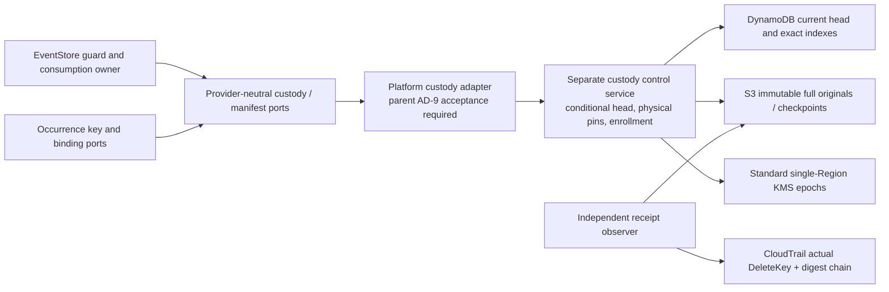

# Architecture Spine — EXT-PROTECTION-1 custody

## Design Paradigm

**Hexagonal custody boundary with a recoverable state machine.** Existing provider-neutral ports surround an independently surviving physical custody authority. Immutable originals and conditional transitions recover interrupted effects; neither actors nor restored application state are physical authority.

This final design proposal is a feasibility substrate, not production selection, acceptance or qualification. All new decisions below are **PROPOSED**. The [decision design](../../../../docs/implementation/ext-protection-1-custody-design-2026-10-18.md) owns the evidence matrix, costs, timing, operational envelope, rejection criteria and exact next implementation. G1/G3 remain open.

## Inherited Invariants

Parent IDs retain their original meaning; local IDs start after the parent's AD-15.

| Inherited | From parent | Binds here |
| --- | --- | --- |
| AD-1 | Platform initiative spine | Platform composes infrastructure; EventStore keeps domain/source behavior. |
| AD-4 / AD-5 | Platform initiative spine | Local Debug/source and CI Release/package modes. |
| AD-6 / AD-7 / AD-8 | Platform initiative spine | Administrator/deputy authority, isolated execution and separate environments. |
| AD-9 | Platform initiative spine | New native AWS custody adapter needs parent acceptance; this proposal grants no exception. |
| AD-10 | Platform initiative spine | Future tests/prototypes have exact run ownership and cleanup; none provisioned here. |
| AD-12 | Platform initiative spine | Independent custody class, erasure-safe old backups, recoverable survivor keys and fence/reissue ownership. |
| AD-15 | Platform initiative spine | Application rollback cannot roll back current authority or key lifecycle. |

## Invariants & Rules

### AD-16 — One separate custody backend boundary [PROPOSED]

- **Binds:** backend selection, provider adapters, deployment and G1/G3.
- **Prevents:** OpenBao snapshot recovery, independent per-target deletes or an application tombstone being substituted for irreversible custody.
- **Rule:** Investigate standard AWS KMS-generated single-Region symmetric tenant epoch keys, DynamoDB conditional heads and S3 immutable checkpoints under a separate custody account/control service. OpenBao 2.6.2 stays HMAC-only. No production adapter or infrastructure follows until feasibility, parent AD-9 acceptance and unresolved contract decisions pass. The literal cross-service native transaction requirement is unmet.

### AD-17 — One original root and one common erasure prerequisite [PROPOSED]

- **Binds:** wrap/unwrap, migration, backups, target identity and key creation.
- **Prevents:** new roots on retry/rotation, collateral survivor loss and alternative recoverable target copies.
- **Rule:** Retain one original 32-byte DEK per complete target, AES-256-GCM wrapped by its original object wrapping key. Preserve complete existing AAD, original root/wrapping-key versions and opaque reference. KMS encrypts the wrapping key under a separately tracked tenant storage epoch; a versioned profile must authenticate object-wrap generation and actual initial/current tenant epoch without reinterpreting old KekVersion values. Before destroying epoch E(g), reencrypt every non-target wrapping key into a verified independent checkpoint under E(g+1), with no selected target copy there. Every older epoch must already be permanently deleted. No next erasure cycle for that tenant starts until E(g) deletion is verified. Permanently register every generation attempt; before arm, delete abandoned/unselected generations that ever received wrappers. Exempt only the exact active successor bound to that original/current preparation and verified survivor checkpoint, which arm adopts. Unknown generation/copy closure blocks arm.

### AD-18 — Current authority survives application rollback [PROPOSED]

- **Binds:** registration, recovery, fencing, allocation, owner-state anchoring and trust.
- **Prevents:** old backups/configuration/owner state becoming current authority or recreating an erased interaction through a new alias/version.
- **Rule:** The separately administered custody service owns a conditional monotonic head, immutable full transition journal, permanent target/interaction enrollment indexes and exact original outcomes. Independent accepted trust pins authority incarnation, account/Region, table ARN/TableId and object identities. Restored tables and old profiles cannot self-promote. Revoke old workload enrollment before replacement admission and reconcile existing admitted-original anchored transitions. Allocate no replacement root for an erased interaction. Complete authority compromise/rollback is outside the survival assumption; loss fails closed.

### AD-19 — Physical pins and irreversible admission have one order [PROPOSED]

- **Binds:** PinDek, UnpinDek, dispatch handoff, reservations and arm.
- **Prevents:** check-then-delete hold races and later governance holds silently overriding an earlier dispatch or a successful effective physical pin.
- **Rule:** All effective physical pins, unknown restrictive state and erasure reservations serialize at the same tenant head. A successful effective pin before arm blocks it. Exact unpin needs independent release authority. The EventStore guard owns governance ordering; G2 must supply a durable handoff before later conflicting pins succeed. A later governance hold cannot retroactively create a successful effective pin over an earlier reserved original. Unknown ordering denies arm. This handoff and Product disposition remain explicit blockers, not implemented capabilities.

### AD-20 — Shared physical cut with forward-only recovery [PROPOSED]

- **Binds:** manifests, survivor preparation, in-flight operations and physical execution.
- **Prevents:** partially deleted target sets, untracked late key release and treating a distributed saga as a native transaction.
- **Rule:** Capture the exact original owner reservation/request and immutable vector; reserve once, fence/drain target holders, prepare every survivor and conditionally arm one old-epoch deletion. No new target copy or replacement batch after arm. Other already-reserved owner originals may queue unchanged; only one physical epoch cycle proceeds. An admitted pre-arm stop stays resumable Unknown under its original, never terminal NotPerformed/NotStarted. Keep the native KMS effect separate from conditional journal commits; pending state may outlive the physical effect. Only recovery of that same durable intent finishes the protocol. Caller lookup starts no new physical effect. There is no claimed native KMS/DynamoDB transaction; reject this candidate unless an accepted observable-atomicity proof meets the governing requirement.

### AD-21 — Actual erasure precedes terminal receipts [PROPOSED]

- **Binds:** result status, independent observation, timing, copy inventory and restore barriers.
- **Prevents:** queued deletion, reversible disablement, missing keys or a signed summary becoming irreversible evidence.
- **Rule:** Select seven-day KMS scheduling, retain Unknown until actual native DeleteKey evidence and integrity chain are independently verified for the armed key, all older epochs and complete buffer/copy closure. Retain original log/digest bytes, signature metadata, original object locations and regional public verification keys. CloudTrail delivery order is not custody order. Actual completion may take more than eight days with evidence delay/outage; no fixed SLA is inferred. A receipt observer is separate from deletion/decrypt authority. Destroyed includes the independent restore barrier. No plaintext key cache, snapshot, swap/core or unaccounted late holder is allowed. Vendor-internal erasure assurance is an explicit acceptance gate.

### AD-22 — Immutable ordered originals outlive response loss [PROPOSED]

- **Binds:** request identity, state mutation, vectors, receipt storage and coverage.
- **Prevents:** forked heads, finite-token replay, altered manifests, recreated signatures/results or false absence after outage.
- **Rule:** Prewrite complete canonical request/checkpoint/receipt objects, verify version/hash and retention, then CAS the small head and immutable operation/event indexes in one regional DynamoDB transaction. Receipt finalization merges its terminal original into current state and preserves intervening survivor roots/pins/operations; it never reinstalls the preparation snapshot. No per-target transaction splitting; 1,000-target vectors live outside 400-KiB items. Keep permanent exact indexes beyond the service's ten-minute token. Use native target digest/order and distinct capability canonicalization. Lookup returns original retained ordered bytes and unique target ReceiptIds. Only authoritative never-started absence is NotStarted; every incomplete start is Unknown. Covered targets reuse their original batch receipts, never a new destructive identity; mixed cohorts need owner-authorized residual handling.

### AD-23 — Existing caller authority remains mandatory [PROPOSED]

- **Binds:** Platform lifecycle/authority ports, EventStore key/binding/manifest adapters and default composition.
- **Prevents:** custody bypassing consumption reservation, governance authority, source-writer leases or release-time authorization.
- **Rule:** Platform owns six-operation durable custody and batch storage; EventStore owns consumption/dispatch/block/activation. Interaction per-key Destroy delegates only to the complete original manifest. Preserve exact registrations, conditional revisions, fences, decision and reservation identities, restore barriers and inherited anchored transition protocol. Implement exclusive encryption and completion leases, retained DigestKey resolution, owned key buffers and release-time current-authority checks. Current OwnedKey disposal has no remote acknowledgement: a provider-neutral key-use token/completion extension and real holder-erasure proof are prerequisites, not adapter-provided facts. An irreversible binding tombstone needs independent proof. Keep provider-neutral callers and missing-provider denial; source/model checks establish no installed capability.

## Consistency Conventions

| Concern | Convention |
| --- | --- |
| Original identity | Complete tenant, target, purpose, root/wrapping version, lifecycle, store and contract; exact owner batch/reservation/request bytes. No alias-only lookup. |
| Byte identity | Existing .NET ordinal target order and target-manifest serialization; separate RFC 8785 capability payload. Native interoperability vectors before adapter use. |
| Bounds | 1–1,000 complete legal targets; proposed 64-MiB request/result bound subject to maximum-byte proof. Growing vectors/state are immutable objects referenced by a head below 16 KiB. |
| Errors | Outage/partial/malformed/started-pending is Unknown/Unavailable. Changed original conflicts; never fabricates a new destructive operation. |
| Backups | Current authority is live-authority-only relative to application restore; wrapped root checkpoints are separate custody recovery units. Audit/receipt encryption and verification trust outlive tenant erasure epochs and all referenced batches. |
| Ownership | Physical executor, independent observer, Administrator and deputy have separate minimum authority. Operations retain original identity across restart and lost response. |

## Stack

| Name | Version |
| --- | --- |
| AWS KMS standard managed-service API | 2014-11-01 |
| Amazon DynamoDB managed-service API | 2012-08-10 |
| Amazon S3 managed-service API | 2006-03-01 |
| AWS CloudTrail managed-service API | 2013-11-01 |

These are verified API versions; current vendor documentation and limits are linked in the companion design. No new runtime, SDK package or server binary is selected or asserted installed.

## Capability → Architecture Map

| Capability / area | Owner | Governed by |
| --- | --- | --- |
| Original wrap/unwrap and no recreation | Platform custody control | AD-17, AD-18, AD-23 |
| Effective pins and reserved manifest | Platform control plus EventStore G2 handoff | AD-19, AD-20 |
| Atomic target fate and all-copy restore proof | KMS epoch plus complete custody inventory | AD-17, AD-20, AD-21 |
| Exact retry, response-loss recovery, ordered receipts | Conditional head, immutable journal and observer | AD-18, AD-22 |
| EventStore occurrence, binding and lease integration | EventStore adapter plus existing owner ports | AD-23 |
| Operational isolation, survival and recovery | Platform Administrator/deputy | Parent AD-6/AD-7/AD-8/AD-12, AD-16, AD-18 |

## Deferred and Open Gates

- **Blocking:** literal native transaction versus demonstrated recoverable atomic protocol; immediate erasure if required; G2 guard/physical-pin handoff; parent AD-9 adapter exception; infrastructure/Region and single-Region availability acceptance; complete all-copy and plaintext-holder assurance; receipt trust/retention lifetime. Resolve before production construction.
- **[ASSUMPTION]** One tenant is one erasure domain. One destructive cycle takes at least seven days, plus vendor/evidence delay. All surviving roots are swept per cycle. Reject or revise through owner decision if the operating envelope is unacceptable.
- **[ASSUMPTION]** Independent custody account/current authority survives application disaster. Total authority loss never falls back to a historical snapshot. Select recovery witnesses/RPO/RTO before enrollment.
- **Deferred with revisit condition:** final SDK/package pins, runtime packaging, concrete resources/quotes, scalable immutable tree/checkpoint representation and worker mechanism follow successful feasibility. No unresolved choice may change single-head ownership or final-erasure criteria.
- Mixed-root snapshots, actual G2 authority installation, independent owner roles/chains and G4–G7 remain their owners' work. No Live qualification, register change or dependency availability follows this design.

## Next Implementation

Only the offline epoch state-machine/copy-graph model and fault cases at `eng/ext-secrets-1/model_epoch_custody.py` and `eng/ext-secrets-1/test_model_epoch_custody.py`, as bounded in the companion design. No credentials, key bytes, infrastructure or production adapter. Adopt this spine into a scoped `bmad-spec` companion before the later production stories; do not treat that adoption as qualification.
