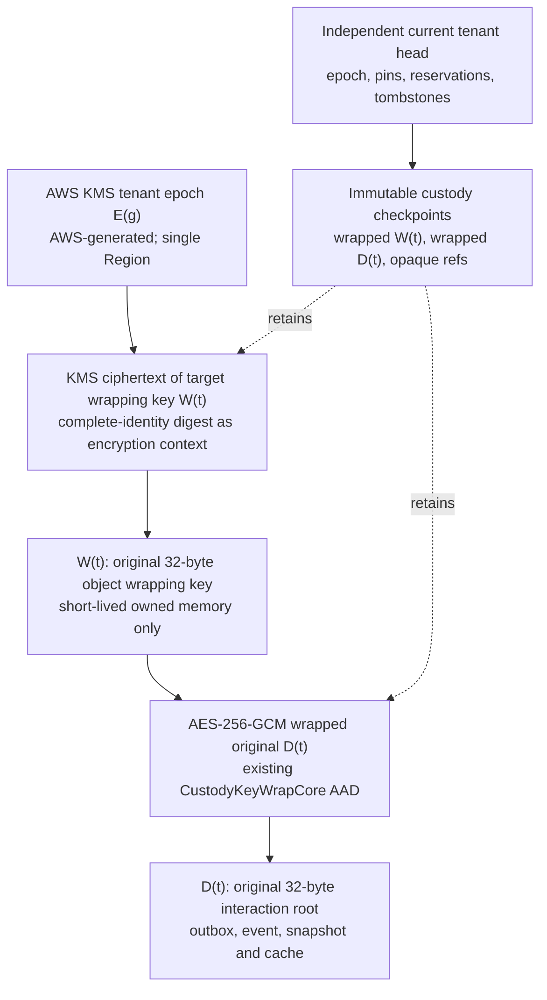
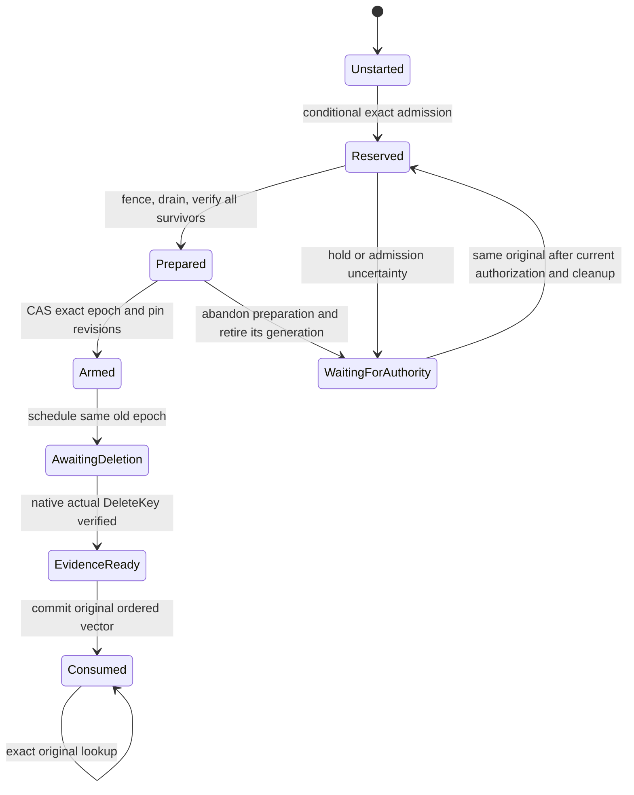

# EXT-PROTECTION-1 — custody after ObservedRevival

Date: 2026-10-18. Purpose: a decision for Platform and EventStore owners. **Recommendation: investigate option B using a separate AWS custody authority, tenant epoch evacuation, and actual permanent deletion of an AWS-generated KMS epoch key. Do not resume production provider construction yet.** This design names a construction and its proof obligations; it does not qualify an installation, resolve G1/G3, approve spending, or declare any dependency Available or Committed.

The construction offers one cryptographic destruction unit for an arbitrary same-tenant manifest of 1–1,000 targets. Its material limitations are **at least seven days to terminal erasure, one outstanding destructive cycle per tenant, and no native transaction spanning KMS and the custody journal**. The last limitation does not meet the input's literal single-native-transaction requirement. Reject this candidate unless an accepted proof establishes that the recoverable protocol satisfies the required atomic behavior. Immediate irreversible erasure is also unsupported. These limitations are decisions to resolve, not implementation details to conceal.

This is a scoped proposal under the existing Platform architecture, not an amendment to it. The companion [architecture spine](../../_bmad-output/planning-artifacts/architecture/architecture-ext-protection-1-custody-2026-10-18/ARCHITECTURE-SPINE.md) fixes the implementation invariants; its append-only memlog records alternatives and assumptions. Proposed calls remain subject to acceptance. No infrastructure, runtime configuration, Agents register, or existing source was changed by this design.

## Binding evidence and scope

The [Platform decision](ext-secrets-1-dek-provider-decision-2026-10-18.md) records the exact OpenBao 2.6.2 negative control: deletion made the target unavailable, but ordinary restoration of its pre-delete Raft snapshot recovered the original plaintext. The [shareable native result](ext-secrets-1-option-a-feasibility-2026-10-18/README.md) records `ObservedRevival`, not qualification. A transaction engine on that same recoverable key hierarchy cannot fix this failure.

The [EventStore acceptance packet](../../../eventstore/docs/implementation/ext-protection-1-owner-acceptance.md) requires exact original custody, all-copy non-revival and original-reservation atomic manifests. Its missing implementations include the physical custody provider, atomic manifest provider, occurrence key provider, binding provider and independent current authorities. HMAC installation supplies none of those ports. G2 and G4–G7 have independent gaps; this document does not close them.

Scope is interaction-root custody for EXT-PROTECTION-1. It does not choose a Product hold disposition, solve mixed-root snapshots, or claim compliance with the separate actor-history policy's exact expiry instant. The latter needs its own design if permanent deletion must occur at an exact time.

Fast-path assumptions for owner review: **[ASSUMPTION]** one tenant is one erasure domain; **[ASSUMPTION]** delayed terminal completion and a surviving independent custody account are acceptable feasibility premises; **[ASSUMPTION]** Paris is an acceptable initial Region to investigate. None of these is recorded as an adopted production decision. The decision table below makes their rejection consequences explicit.

Inherited Platform constraints are AD-1 composition ownership, AD-4/AD-5 build modes, AD-6 administration/recovery roles, AD-7 executor isolation, AD-8 environment separation, AD-9 Dapr boundaries, AD-10 test-run ownership, AD-12 independent custody/recovery and AD-15 forward-compatible rollback. In particular, **AD-9 requires Administrator acceptance recorded in the parent spine for a new native AWS custody adapter exception**. This proposal cannot grant itself that exception. AD-12's recoverable backups remain binding: survivor key checkpoints must remain usable after every retired epoch is destroyed.

## Unmet requirements and decisions for acceptance

| Requirement/decision | Current disposition and exit condition |
| --- | --- |
| Native transaction destroys up to 1,000 roots and records outcomes | **Unmet.** AWS provides no transaction spanning KMS and DynamoDB. A single epoch gives common target fate, with forward-only receipt recovery. Accept only if a bounded proof and owner decision establish that this satisfies the required contract; otherwise select another backend. Do not silently weaken the native criterion. |
| Immediate or exact-time irreversible destruction | **Unsupported.** KMS's minimum waiting period prevents it. Accept delayed terminal completion explicitly or reject; no scheduled purge counts as final. |
| All-copy erasure and independently surviving anti-recreation authority | Designed, **not implemented/qualified**. Need actual complete inventory, AWS-internal assurance acceptance, no alternate wrapping path, lease/buffer proof and rollback/reissue adversarial evidence. A vendor DeleteKey event alone is insufficient for our composition. |
| Linearized physical hold pins versus committed dispatch | **Unresolved G2 dependency.** Specify/prove guard handoff, unknown ordering and late-hold behavior without ignoring a successful effective pin. Product chooses downstream hold disposition. |
| Existing key-version and buffer-lifetime contracts | **Unresolved.** Ratify the versioned object-wrap/tenant-epoch receipt schema without reinterpreting old KekVersion values, and add the missing remote key-use completion acknowledgement. Existing adapters/Dispose alone cannot prove all-copy erasure. |
| New infrastructure/provider boundary | **Unapproved.** Decide AWS/jurisdiction/Region, account ownership, network/availability budget, custody deployment packaging and parent AD-9 exception. Parent AD-12 recovery constraints remain binding. |
| Availability, RPO/RTO and throughput | **Unqualified.** Accept single-Region current authority and per-tenant serialization, or reject. Restoring a current-authority table is not ordinary failover. Survivor checkpoints must recover old application references within accepted RTO. |
| Immutable receipts and public trust lifetime | Protocol specified; retention duration/extension responsibility, signing/observer trust and current receipt service not installed. Every referenced batch must retain verification until its references retire. |
| Complete six-operation implementation and EventStore integration | Missing. Work starts only after erasure feasibility and contract gates; retain default refusal meanwhile. |
| Remaining owner gates | G2/G4/G5/G6 remain independently open; G7 has no complete canonical target. No Live/OQ-5.4-1/Agents consumer or register transition is authorized here. |

## Backend and alternatives

Use a Platform-owned custody control service in a **separate AWS custody account and failure domain**, independent of the Platform/EventStore node, database, OpenBao, deployment credentials and restore automation. Proposed initial location is `eu-west-3` (Paris), subject to jurisdiction, service/quota and connectivity acceptance. There is no claim that an account, endpoint, quota or service instance has been installed or is available to this project.

| Component | Concrete version/binding | Responsibility |
| --- | --- | --- |
| Standard AWS KMS | API `2014-11-01`; customer-managed `SYMMETRIC_DEFAULT`, `ENCRYPT_DECRYPT`, `Origin=AWS_KMS`, `MultiRegion=false`; no custom key store | One AWS-generated, non-exported plaintext epoch KEK per tenant generation; actual key deletion retires all target paths left under it. |
| Amazon DynamoDB | API `2012-08-10`; one regional table, on-demand initial capacity, no global table or DAX authority path | Small conditional tenant head, enrollment/fence state, immutable operation indexes and ordered journal indexes. Strong reads or `TransactGetItems` for authority. |
| Amazon S3 | API `2006-03-01`; versioned general-purpose buckets, Compliance Object Lock on committed custody checkpoints and receipts | Large immutable request/state/receipt objects, selected by exact bucket/key/version/hash. Separate backup class from application ciphertext. |
| AWS CloudTrail | API `2013-11-01`; trail with log-file integrity validation and independently retained digest chain | Native actual `DeleteKey` evidence, distinct from scheduling, policy changes or absence. |
| Platform service boundary | Existing Platform custody library and provider-neutral ports; new bounded backend adapter proposed | Authorization, complete-copy inventory, leases, original-request recovery, receipt verification and recovery hooks. Existing source owns runtime/package versions; no new SDK version is selected before feasibility. |

Managed services have published API versions, not a customer-pinnable server release. The API versions above are verified in AWS's [KMS reference](https://docs.aws.amazon.com/kms/latest/APIReference/kms-api-reference.pdf), [DynamoDB history](https://docs.aws.amazon.com/amazondynamodb/latest/developerguide/DocumentHistory.html), [S3 reference](https://docs.aws.amazon.com/AmazonS3/latest/API/), and [CloudTrail history](https://docs.aws.amazon.com/awscloudtrail/latest/userguide/cloudtrail-document-history.html). These API dates do not pin current service behavior or prove project access.

| Alternative | Decision |
| --- | --- |
| Ordinary OpenBao Raft / KV / transit | Reject for this custody class: retained real restore demonstrated revival. Keep HMAC in its existing scope. |
| Custom OpenBao engine plus external erasure authority | No longer the first target. It still needs the entire external erasure construction, specialized transactions and rollback proof; the installed cluster gives no erasure shortcut. |
| Per-target KMS/HSM keys plus an atomic database tombstone | Reject: 1,000 irreversible key deletions can stop after a proper subset. An atomic deny flag does not make that physical sequence atomic. |
| AWS CloudHSM with ordinary backups | Reject as proposed: AWS instructs deletion of all backups containing removed material, and its CLI deletes one key at a time. Backups pending deletion are restorable for seven days. [Backup behavior](https://docs.aws.amazon.com/cloudhsm/latest/userguide/backups-using.html), [key deletion](https://docs.aws.amazon.com/cloudhsm/latest/userguide/cloudhsm_cli-key-delete.html), [backup deletion](https://docs.aws.amazon.com/cloudhsm/latest/APIReference/API_DeleteBackup.html). |
| Imported KMS epoch material with immediate material deletion | Do not recommend first. Reimport of the original material restores usability; generation buffers, escrow and encrypted import artifacts add recovery paths. AWS documents eventual consistency and independent multi-Region copies. [Material deletion](https://docs.aws.amazon.com/kms/latest/APIReference/API_DeleteImportedKeyMaterial.html), [reimport](https://docs.aws.amazon.com/kms/latest/APIReference/API_ImportKeyMaterial.html), [24-hour import artifacts](https://docs.aws.amazon.com/kms/latest/APIReference/API_GetParametersForImport.html). No instant all-copy guarantee is inferred. |
| AWS-generated tenant epoch, survivor evacuation, actual permanent deletion | **Recommended bounded feasibility target.** Avoids customer-held epoch key material and deletes one common cryptographic prerequisite. Accepts delayed completion and a custom journaled protocol; neither is qualified today. |

## Key hierarchy and why an old backup cannot decrypt

The stable target is `(TenantId, AgentInteractionId, TargetProtectionKeyAlias)`. Its DEK `D(t)` is created once and retained before any successful wrap response or source use. `WrapDek` retry resolves that original; it does not generate a second root. Caller-supplied key material, if supported later, must be compared privately to the original on retry; changed input conflicts without publishing a key fingerprint.

`D(t)` is wrapped with a distinct original 32-byte wrapping key `W(t)`, preserving the existing AES-256-GCM wrapper and its complete identity, purpose, root version, lifecycle version, store target, contract and KEK-version AAD. Registration's immutable `KekVersion` identifies this tenant-scoped object wrapping-key generation. The **storage epoch** of KMS-encrypted `W(t)` is separate metadata; changing it never rewrites the original DEK, original registration/AAD, or signed capability. There is no surviving shared tenant KEK that can directly unwrap `D(t)` after `W(t)` becomes unrecoverable.

This two-level hierarchy needs an explicitly accepted versioned custody profile. Keep the existing registration's original purpose-bound `KekVersion` semantics; do not reinterpret existing registrations in place. A new wrap receipt/checkpoint must authenticate both the original object wrapping-key generation and initial/current **actual tenant KMS epoch ARN and ordinal**, with current placement allowed to advance independently. Specify those new private fields and their canonical bytes before implementing adapters. The existing DTO alone does not express this hierarchy; ratifying the tenant-KEK/version mapping is an unresolved compatibility gate.

KMS encrypts only `W(t)`, with an opaque digest of the full canonical custody identity and wrapping-key version as encryption context. Keep identity plaintext out of KMS tags/descriptions/context and CloudTrail. Wrapper objects bind the digest back to the full private identity. Native KMS ciphertext is not substituted for the AES-GCM wrapper. AWS documents that standard symmetric keys are AES-256-GCM outside China Regions and their plaintext material does not leave KMS. [CreateKey](https://docs.aws.amazon.com/kms/latest/APIReference/API_CreateKey.html).

At a stable epoch, every recoverable root in a tenant has a current wrapper under `E(g)`; every older epoch key is already permanently deleted. To erase set `T`, create `E(g+1)` and use KMS `ReEncrypt` to move **all surviving wrapping keys**, including held roots, into a fresh durable checkpoint. Do not copy any member of `T` into `E(g+1)`. `ReEncrypt` keeps this wrapping-key plaintext inside KMS. [ReEncrypt](https://docs.aws.amazon.com/kms/latest/APIReference/API_ReEncrypt.html).

Once survivor coverage is independently verified, the only recoverable wrapping-key path for every member of `T` is the **same** `E(g)`. Actual permanent deletion of that one key removes the prerequisite for the whole set. Any old root wrapper in a snapshot, export, log, orphan staging object or restored clone remains ciphertext under a deleted epoch. Survivor recovery uses the current independent checkpoint, even when restoring older application records containing the original opaque root reference.

This is a construction argument, not vendor certification of our composition. It fails if any selected wrapping key was also encrypted under another surviving key, any root/wrapping plaintext escaped, an older epoch is still recoverable, or survivor coverage is incomplete. The pre-arm inventory must prove those conditions. No erasure cycle may overlap a prior cycle in the same tenant: the prior old epoch must reach verified permanent deletion first. New roots after cutover use only the successor epoch. Ordinary KMS automatic rotation is disabled for this class; policy rotation uses the same forward evacuation protocol, not retained old decryption generations.

**Abandoned generations are part of that closure.** Keep a permanent generation registry with every create attempt, native ARN and `Allocated/Prepared/Adopted/Retiring/Deleted` state. A failed CAS, canceled preparation or pin race can leave survivor wrappers under an unadopted successor key. Before each arm, permanently delete every abandoned or unselected generation that ever received any root wrapper, including generations numerically newer than the current epoch, and retain its actual deletion evidence. The sole exception is the exact active candidate `E(g+1)`, bound to that original reservation, current preparation attempt and verified survivor checkpoint; it must contain no selected target wrapper and becomes adopted by the arm transaction. An ambiguous generation/copy attempt remains Unknown until resolved; it cannot be treated as empty. Old-key scheduling must not begin while any selected root has a path through another generation. This cleanup can add another seven-day wait.

## Independently surviving authority and rollback exclusion

The authority consists of the custody-account service, its current DynamoDB state, immutable checkpoint/journal objects, independent public receipt trust and KMS. The **AWS KMS service** is the material-erasure authority; the **custody control service** owns monotonic admission, pin/reservation ordering, fencing, root reissue prevention and exact original outcomes. Platform owns its operation; Administrator and the recovery deputy have separate recovery identities and MFA under the parent architecture. Application restore credentials cannot modify its policy, table identity, epoch lineage or journal.

A tenant head contains authority-instance id, tenant id, revision, checkpoint bucket/key/version/hash, previous committed-event hash, current epoch ARN, enrolled owner/fence revision and pending erasure identity. Keep it below 16 KiB by storing all vectors and growing state outside the item. A compare-and-swap (CAS) of the tenant head uses both expected revision and expected hash. A transaction conditionally changes the head and inserts unique operation/event indexes; no TTL applies to destructive identity, tombstone or original-outcome indexes. The durable immutable event object contains the full transition and previous hash, not merely a signed summary.

Prewrite and verify an immutable S3 object before publishing its pointer. A lost write response is resolved by exact version/content verification. A prepared object is not a committed receipt. Commit is the conditional head/index transaction; lookup follows its exact pointer. S3 single-object updates are atomic and strongly consistent, but S3 does not provide a transaction with DynamoDB. [S3 consistency](https://docs.aws.amazon.com/AmazonS3/latest/userguide/Welcome.html), [conditional writes](https://docs.aws.amazon.com/AmazonS3/latest/userguide/conditional-writes.html).

The independently accepted authority profile binds account, Region, authority instance, table ARN **and TableId**, bucket identities, receipt trust revision and enrolled execution identities. Pin the instance incarnation, not a reusable table name. Restore of DynamoDB creates a new table; it is never automatically promoted to authority. [DynamoDB restore](https://docs.aws.amazon.com/amazondynamodb/latest/developerguide/pointintimerecovery_restores.html). Checkpoint hashes and WORM records are evidence; they cannot make a restored head current on their own.

Recovery of the Platform node revokes its old enrollment at this surviving service before replacement admission. A restored actor ledger must reconcile its exact revision/digest and admitted originals through the existing anchored-transition protocol. Old configuration, old owner state or a still-valid historical signature cannot enroll a new owner, choose another authority, unwrap a target, or authorize a new root at an erased identity. Every root allocation checks the permanent identity index independently of the caller's requested new alias/root version. A new alias for the **same full erased target identity** is forbidden; a legitimately different target requires separate EventStore enrollment, not automatic recreation.

For alias changes, retain an interaction enrollment index as well as the complete target index: a caller cannot replace `TargetProtectionKeyAlias` on an erased interaction and treat that as a new permitted root. Only a genuinely new owner-authorized interaction identity may create a new root; custody cannot mint it. Replay of a completed wrap returns its retained original outcome or erased status, never new material.

Threat boundary: a restored or compromised application owner is in scope. Simultaneous compromise/rollback of the independent authority and its administrative trust, malicious pre-erasure plaintext exfiltration, or compromise of AWS itself is not solved here. An organization administrator who can replace all trust and policy is not cryptographically constrained by our software. Total authority loss fails closed; recovery requires an independently accepted current head/witness and full journal, never promotion of an arbitrary old backup. Cross-Region availability of current authority is an unresolved operational decision; this proposal provides no automatic Region failover.

## Destruction, pins and exact recovery protocol

These internal states do not change EventStore's result enum. Any persisted start that has not reached `Consumed` maps to `Unknown`; only independently authoritative absence of **any start** under the exact original reservation maps to `NotStarted`. An admitted manifest has no terminal `NotPerformed` state: after a safe pre-arm stop it retains its exact original and resumes only when current authority, holds and generation cleanup permit. EventStore currently has no terminal zero-effect manifest result. Adding one would require a separate owner-approved contract change; pretending an admitted original was never started is prohibited. Per-key lifecycle `NotPerformed` remains its existing separate contract. Provider transport failure, malformed results and missing evidence also map to `Unknown`/Unavailable.

1. **Capture the original.** Deep-copy and strictly validate the complete EventStore `DeletionBatchConsumptionRequest`, detached JWS, issued/dispatch revisions, sorted targets and exact original `ConsumptionReserved` receipt. Obtain current independent enrollment/guard/compromise authority; signatures alone are insufficient. Key the custody operation by authority instance, tenant, BatchId and original reservation; bind the entire canonical captured request hash. Changed content under any reused batch/reservation conflicts.
2. **Reserve at the physical owner.** The tenant-head transaction checks current fence/enrollment, exact roots and versions, all effective pin state, and the original-reservation authorization. It publishes one manifest pointer and excludes competing destructive cycles and root allocation for selected identities. No per-target delete calls occur. An active or unknown effective pin causes zero target effects.
3. **Fence and drain key users.** Close target read/write/encryption/completion leases, retain original in-flight operations, and wait for all owned key buffers and decrypt operations to quiesce. Target source-writer completion cannot commit after this barrier. If the custody service cannot account for a host or a late operation, the result remains Unknown. Fence epoch callbacks alone do not erase previously released buffers.
4. **Prepare survivors.** Freeze the tenant key map/pin revision for the finite sweep; establish `E(g+1)` under a durably recorded generation attempt. Account for ambiguous CreateKey results and every orphan epoch before proceeding. Reencrypt every non-target `W(t)`, including held objects. Persist and independently read back a complete successor checkpoint and backup copy; preserve all original DEKs, references and pinned state. Unknown or failed coverage prevents scheduling. The initial implementation may pause all tenant root acquisitions during this sweep; measure this outage, rather than assuming invisible migration.
5. **Arm once.** A conditional head transaction validates the frozen roots/pins/fence, full survivor-checkpoint hash and complete old-epoch copy closure, then records the original destructive intent for `E(g)` and activates survivor references on `E(g+1)`. A pin revision change causes retry or safe refusal before arm. After arm, recovery proceeds forward under the same intent; it never starts another manifest or copies selected roots into a successor. Only the custody executor has permission to schedule this exact old epoch. It has no `CancelKeyDeletion`, `EnableKey`, export or policy-edit permissions. Administrator intervention that cancels deletion keeps the operation Unknown and triggers reconciliation; it cannot produce a success receipt.
6. **Wait for actual erasure.** Schedule `E(g)` with `PendingWindowInDays=7`. Scheduling/disablement is reversible and certifies no destruction. AWS's cryptographic documentation says the final deletion removes the KMS key and its associated HSM backing keys. [Key deletion](https://docs.aws.amazon.com/kms/latest/cryptographic-details/key-deletion.html). No target result becomes terminal during this wait.
7. **Independently attest and commit.** A separate observer retains the actual AWS `DeleteKey` event for the exact account/Region/key ARN, validates the CloudTrail log/digest signature chain against separately retained trust, and binds it to the armed intent, prior epoch closure, buffer/copy barrier and complete manifest. Retain original log/digest bytes, original bucket/path references, digest signature object metadata and the appropriate regional public keys; copying payload bytes alone loses validation inputs. CloudTrail ordering is delivery evidence, not the linearization order of custody operations; the conditional custody head establishes that order. Absence or a failed decrypt is corroboration only. The observer has read/attestation authority, no decrypt or deletion authority. AWS documents a distinct native event after actual deletion; it is not a synchronous, per-manifest destruction certificate. [DeleteKey event](https://docs.aws.amazon.com/kms/latest/developerguide/ct-delete-key.html), [log integrity](https://docs.aws.amazon.com/awscloudtrail/latest/userguide/cloudtrail-log-file-validation-intro.html), [custom/offline validation](https://docs.aws.amazon.com/awscloudtrail/latest/userguide/cloudtrail-log-file-custom-validation.html).
8. **Retain one original vector.** Prewrite the canonical signed receipt artifact, read it back, then atomically publish its exact pointer with the consumed operation and tenant head. Return `DeletionTargetReceipt(Target, OriginalBatchId, ReceiptId)` in the supplied canonical order, unique ReceiptIds, one per target. Lookup returns those same retained bytes and identities. A crash after key deletion but before receipt publication remains Unknown and recovers from the already armed intent and native event; it never reexecutes target destruction.

Survivor writes and effective pin changes may advance the head during the deletion wait. Receipt finalization must merge only the original operation's terminal receipt/tombstones into the **current** checkpoint and CAS its current revision/hash; it must preserve those intervening roots, pins and operations. The armed preparation checkpoint remains immutable evidence, never a snapshot to reinstall over the current map. A CAS conflict reloads current state and retries that same receipt publication.

The KMS final deletion is one common cryptographic cut; DynamoDB supplies conditional state transitions. **There is no distributed native atomic commit between those services.** A pending journal can survive a completed physical effect. The proposed forward recovery can preserve all-or-none target semantics, but the input explicitly demands native transactional physical destruction and retained outcomes. That stricter requirement remains unmet until owners accept a demonstrated equivalence or choose a different backend. Source tests cannot waive it.

### Hold ordering across owners

`PinDek`/`UnpinDek` retain original operation identity, exact hold id, release authority and immutable result. Physical pin changes and destructive reservations must compare-and-swap the same custody tenant head. A current or unknown **effective** pin prevents arm; a read of a separate hold store followed by scheduling deletion is prohibited.

EventStore separately requires a restrictive governance hold ordered before dispatch to block, while a proven later hold cannot retroactively cancel an already dispatched batch. Therefore custody cannot blindly materialize every later governance hold as an effective pin against an earlier admitted original. The guard-to-custody handoff must establish a durable ordering token before a later conflicting pin can succeed. An attempted retroactive physical pin returns a retained conflict/pending result; a governance hold registration must not falsely report that the earlier batch is physically pinned.

The exact handoff must use the G2 independent admitted-transition/current-authority mechanism and be tested against the real guard; this document does not invent an atomic transaction across EventStore and AWS. Unknown dispatch/hold ordering denies arm. **This is an unresolved integration gate**, including the Product decision for subsequent hold obligations. No successful `PinDek` may later be ignored by the physical owner. If the G2 protocol cannot establish this ordering, reject the design rather than redefining a hold.

### Failure and response-loss matrix

| Failure boundary | Durable interpretation and required recovery |
| --- | --- |
| Before reservation commit, original transport lost | Strong exact lookup at the surviving authority; only proven absence is NotStarted. Retry the same request/reservation only. |
| Prepared S3 object but head CAS failed | Orphan staging object, no committed operation/effect. Inventory it; do not expose it as a receipt or use its successor key for targets. |
| Root generation or survivor `ReEncrypt` response lost | No plaintext release or erase; resolve recorded object/generation attempts and copy inventory. Abandonment cannot leave an untracked decrypting epoch. |
| Pin races prepare/arm | Same-head CAS chooses one order. A pin that succeeds before arm blocks it; stale preparation cannot arm. |
| Arm acknowledged, scheduling response lost | Original remains Unknown. Reconcile the exact old key state and retained schedule event. A durable worker may finish that same armed intent; caller Lookup itself creates no new physical operation. |
| KMS canceled/unavailable, or wait elapsed without authenticated actual event | Unknown; targets remain fenced. Never infer final erasure from wall clock or `NotFound`. No second destructive cycle. |
| Physical deletion completed; response/event/receipt commit lost | Recover exact armed intent and original native event, then publish its single retained receipt artifact. No replacement batch or fresh root. |
| Receipt S3 PUT or signature response lost | Recover the exact prepared artifact/version. Commit only one original byte sequence; a nondeterministic signer is not reinvoked to manufacture an equivalent signature after publication. |
| Receipt committed; response/actor save lost | Return the byte-identical original vector through original lookup. EventStore reconciles its pending original. |
| Restored actor, config or custody backup | Current independent profile/head controls. A cloned table/checkpoint cannot become authority; old wrappers under deleted epochs cannot decrypt even if the old owner denies knowledge of deletion. |

Existing thirty-second observation deadlines remain bounded; durable work can take days. Timeout is Unknown, not rollback or cancellation of already armed work. Preserve existing late-I/O quiescence rules; no reentry/new operation while the original effect is unresolved.

## Bounded manifests, immutable receipts and coverage

Use EventStore's `StringComparer.Ordinal` ordering by AgentInteractionId, then TargetProtectionKeyAlias, and `DeletionBatchCapabilityIdentity.TargetManifestDigest`; do not replace it with a new canonicalization. The target digest is uppercase SHA-256 over the existing serialized `string[][]` in supplied order. Capability payload signing uses its separate RFC 8785 representation. Share native canonical bytes or prove cross-language vectors, including Unicode/control escaping and maximum exact integers.

Validate the legal maximum, not just 1,000 short names: each identity component is bounded in both UTF-16 and strict UTF-8 by the consuming contract. A 1,000-target request can exceed six MiB before JSON escaping/signatures/receipts. Proposed transport bound is 64 MiB for the captured request plus ordered result artifact, subject to a native worst-case byte-size proof. No convenience gateway limit may silently reduce the supported 1,000 legal targets.

DynamoDB permits 100 transaction items, four MiB aggregate and 400 KiB per item; its request token provides only ten minutes of idempotency. Thus **do not write 1,000 target rows in one transaction or split that into ten purportedly atomic transactions**. The proposed transaction touches a small head and operation/event indexes, while a complete immutable checkpoint object owns all roots, pins and ordered results. Permanent exact-operation indexes supply idempotency after the service token expires. [Transaction behavior](https://docs.aws.amazon.com/amazondynamodb/latest/developerguide/transaction-apis.html), [limits](https://docs.aws.amazon.com/amazondynamodb/latest/developerguide/Constraints.html).

Compliance Object Lock protects a particular object version; new versions and delete markers can still exist. Always bind the exact version and verified hash. It supplies neither journal ordering nor a trustworthy current head. The conditional revision/previous-hash chain supplies order and prevents normal writer forks. Retention must span the complete referenced batch lifetime; no fixed short TTL is acceptable. A finite retention/extension policy and trust-key retirement rule must be accepted before production. [Object Lock](https://docs.aws.amazon.com/AmazonS3/latest/userguide/object-lock.html).

For a later exact-target request, return authenticated coverage through EventStore's original-coverage path using each target's original BatchId and ReceiptId. Do not allocate another destructive identity or return an earlier batch's receipts as `Consumed` for a new batch: the native manifest result requires its own original BatchId on every receipt. An entirely covered cohort needs no KMS operation. A mixed covered/live cohort requires the existing EventStore original-coverage protocol; the adapter must refuse until the owner supplies a valid residual reservation. It may not silently change signed target membership or combine unrelated physical results into a newly claimed atomic original. Coverage is evidence, not successor authority.

## Full copy inventory and operational exclusion rules

| Copy/recovery path | Required exclusion or surviving mechanism |
| --- | --- |
| OpenBao/Raft replicas, logs and snapshots | No interaction root, wrapping key or epoch material enters this custody class. Installed HMAC remains unrelated. Restoring OpenBao cannot choose a new DEK authority. |
| KMS internal HSM replicas/backing generations | Standard single-Region AWS-generated key only; final deletion of its full logical key and associated backing keys is the vendor boundary. No custom HSM backups or multi-Region replication. Native physical per-replica examination is unavailable; vendor assurance must be accepted explicitly. |
| Custody S3 checkpoints/backups/exports and journal/table backups | Only encrypted W/D objects and value-free metadata. The erasure inventory includes every historical epoch that can decrypt a retained wrapper. Survivors have independent current encrypted backups before old-key scheduling; backup encryption does not substitute for epoch erasure. |
| DynamoDB replicas, transaction logs, streams, PITR | Never contain plaintext keys. No streams/GSI/eventually consistent cache is a current authority. Restored tables get new identities and cannot self-enroll. |
| Application source/outbox/event/snapshot/cache/backups | Ciphertext and original opaque references only. Encrypted content survives; restore resolves the current root by reference or an authenticated terminal tombstone. Mixed-root snapshots remain G4 work. |
| Custody/adapter/caller memory and in-flight RPCs | Owned buffers, bounded lifetime, actual zeroing, no string conversion, no key cache; quiesce all pre-fence decrypt/writer leases. Disable swap/core/hibernation/VM memory snapshots and diagnostic capture on key-handling hosts. Audit SDK/TLS copies; zeroing one managed array does not prove complete process-memory erasure. Unreachable/late holder blocks the receipt until reconciled. |
| Logs, telemetry, traces, support bundles and request recordings | Value-free identities/hashes of public artifacts only; never plaintext keys, wrapped import material, full private requests, authentication secrets or decrypted content. KMS context uses opaque identity digests. Review interception/middleware/debug tooling too. |
| Restored configuration, old private credentials and owner state | Independent enrollment/fence revision and anchored transition authority reject rollback. App config contains references; it cannot redirect custody or make an old root allocation current. |
| Recovery operators and break-glass | Independent MFA identities and audited, forward-only recovery. No direct decrypt/rewrap path bypasses physical owner pin/reservation checks. Record any exceptional policy change; stop terminal attestation until its effect is reconciled. |

The inventory must name actual resource ids, retention/copy locations, owners, recovery class, fence-and-reissue owner and every decrypting-key lineage before a terminal receipt is allowed. A generic assertion that backups are excluded is insufficient. Cross-account receipt copies are allowed; copying a selected key into a surviving KEK or another KMS Region is not.

Audit/receipt storage encryption and receipt-signing trust have a separate lifecycle from tenant erasure epochs. Never encrypt their only retained copy under an epoch scheduled for destruction. Preserve public verification keys and any audit-storage decrypting keys for the full referenced lifetime; WORM cannot compensate for deleting the key that makes a receipt readable.

An additional observer signature binds independent observation, not mathematical proof of hardware destruction. The acceptable assurance level for AWS-internal copies and CloudTrail final-event evidence is an owner decision. If EXT-PROTECTION-1 requires independently inspecting every physical vendor copy, this backend cannot supply that capability from its public API.

## Existing interface integration

Keep AWS SDKs, native ciphertext formats, resource ids and policy details inside a named Platform backend adapter/control service. Application and shared caller contracts remain provider-neutral. Standard Dapr secret/state calls do not expose this erasure/attestation protocol. The proposed exception is **Platform interaction custody epoch/manifest authority**, owned by Platform, limited to the six operations, exact lookup, anchored transitions and bounded current lease/attestation operations; parent AD-9 acceptance is a prerequisite. A separate security/failure-domain deployment of the control authority is new infrastructure and requires approval before provisioning; do not silently add another application host or vault.

| Existing port | Mapping and required work |
| --- | --- |
| `CustodyKeyWrapCore` | Retain complete AES-GCM identity/AAD and owned zeroed buffer behavior. Add durable wrap/unwrap orchestration; the primitive itself is not a physical backend. |
| `CustodyKeyRegistration` / `CustodyKeyObjectIdentity` | Preserve tenant/object/purpose/alias/root/lifecycle/store/contract/KEK identity, original wrap receipt and stable opaque reference. A deployment selects one store/contract identity; a restored configuration cannot replace it. |
| `ICustodyKeyLifecycleProvider.ExecuteAsync/LookupAsync` | Implement exact pin/unpin/original lookup against the same control head. Interaction `Destroy` is only a view of the original complete manifest reservation and result; never a per-key KMS delete loop. Export-envelope custody stays outside this interaction-only design. |
| `ICustodyKeyLifecycleAuthority` | Implement current private operation/effect authorization, registration verification, independent receipt/restore-barrier verification and inherited `IAnchoredStateTransitionAuthority` admission/conditional staging/recovery. Legacy `RecordRevisionAsync` alone remains insufficient. `Destroyed` requires the independently verified RestoreBarrierReceiptId. |
| Platform six-operation façade | Add missing production `WrapDek`, `UnwrapDek`, `PinDek`, `UnpinDek`, `DestroyDek`, `DestroyDekManifest` only after the erasure gate. The current per-key DTO cannot express an atomic manifest; add a provider-neutral batch port instead of iterating the actor. |
| EventStore `Server.Security.IAtomicDeletionManifestProvider` | Adapter delegates `ConsumeAsync/LookupAsync(DeletionBatchConsumptionRequest, reservationReceiptId)` without changing tenant, BatchId, reservation, digest, signed bytes, order or original target receipts. Preserve `NotStarted/Consumed/Unknown`; conflict is denied/Unknown with retained diagnostics, not a fabricated new enum/result. This interface resides in Server, not Contracts. |
| `IInteractionOccurrenceKeyProvider` | Bind retained DigestKey separately from root DEKs; implement exclusive once-per-reference encryption lease, current write/read authority, owned root buffer and `IsCurrentAsync` before ciphertext/plaintext release. Retries or unknown leases never authorize re-encryption. Installed HMAC mappings are not automatically enrolled DigestKeys. |
| `IInteractionProtectionBindingProvider` | Resolve independently enrolled complete target/occurrence, acquire exact source-writer completion lease, and verify an irreversible tombstone from the independent receipt/authority chain. Missing key or outage returns false for erasure proof. |
| EventStore consumption owner and guard | Continue owning capability verification, sole current attestation, committed issue/dispatch, compromise block, activation comparisons and original consumption reservation. Supply accepted G2 ordering/fence tokens; custody cannot mint or replace them. |

Relevant local sources: [Platform provider](../../src/Hexalith.Platform.Custody/ICustodyKeyLifecycleProvider.cs), [authority](../../src/Hexalith.Platform.Custody/ICustodyKeyLifecycleAuthority.cs), [wrap primitive](../../src/Hexalith.Platform.Custody/CustodyKeyWrapCore.cs), [EventStore manifest port](../../../eventstore/src/Hexalith.EventStore.Server/Security/IAtomicDeletionManifestProvider.cs), [occurrence key port](../../../eventstore/src/Hexalith.EventStore.PayloadProtection/IInteractionOccurrenceKeyProvider.cs), [binding port](../../../eventstore/src/Hexalith.EventStore.PayloadProtection/IInteractionProtectionBindingProvider.cs).

**Required lease/lifetime extension:** the existing `InteractionOccurrenceOwnedKey.Dispose()` zeros its local byte array but sends no custody release acknowledgement. None of the current ports proves that remote buffers, TLS/SDK copies or late operations are gone. Before production, agree a provider-neutral key-use lease/token and authenticated completion/zeroing acknowledgement, associated with exact caller incarnation, target, operation and fence revision, and wire it through the actual ownership/disposal path. A missing acknowledgement remains an unknown holder; lease expiry or cancellation alone is not memory-erasure proof. A backend adapter alone cannot supply this extension. The feasibility model may represent it abstractly but must label the premise unimplemented; F1 must decide whether a host-isolation/termination proof can cover unresponsive holders.

The existing lifecycle actor also bounds one tenant ledger to 1,000 keys and 10,000 retained requests. The backend's larger-N cost examples below are not claims that this actor already supports those sizes. Production integration must specify bounded actor projection/journal growth and archival recovery while retaining permanent original outcomes in the physical authority. Sharding a projection may not split the tenant erasure domain or turn one manifest into independent per-actor destroys. Do not silently raise bounds or discard original receipts to admit new work.

## Infrastructure and operating envelope

### Required infrastructure

Required new resources are separate custody-account administration and workload identities; an isolated control-service runtime with private authenticated ingress and restricted egress; a regional DynamoDB authority table; versioned locked checkpoint/receipt buckets with independent copies; standard KMS epoch keys and separate receipt-signing trust; an integrity-validated CloudTrail trail; independent observer/executor identities and retained logs; monitoring, paging and recovery workflows accessible to Administrator and deputy. Separate environments must have separate accounts or equivalently qualified isolation, tables, keys, trust, buckets and enrollments. No production app restore may roll these resources back.

Use the existing Platform operational owner and run lifecycle. A later approved implementation may need an isolated infrastructure control-service process because its authority cannot share the node being restored; packaging and public endpoint identities are unresolved. No new scheduler framework is chosen. Durable pending work requires an existing qualified worker mechanism or an explicitly selected bounded worker in this control service, with recorded ownership and restart recovery.

### Latency and throughput

AWS requires 7–30 days between scheduling and deletion. The documented actual period can extend up to another 24 hours; native evidence delivery and outages add further delay. This proposal selects seven days, not a hard eight-day SLA. [Deletion timing](https://docs.aws.amazon.com/kms/latest/developerguide/deleting-keys.html). Key scheduling is reversible throughout the wait, and released plaintext data keys are unaffected until their use is actually prevented. **No early irreversible receipt is permitted.**

Only one destructive cycle per tenant can be outstanding under the single-common-epoch proof. With batches of 1,000 targets, the theoretical throughput is roughly 1,000 targets per seven-to-eight-day cycle, before outages or abandoned-generation cleanup; smaller batches cost the same survivor sweep and cycle. Other tenants can proceed independently. During the wait, survivor reads/new roots can use the successor epoch; selected targets remain unavailable but recoverable within KMS until deletion. EventStore can already have persisted `ConsumptionReserved` originals for other batches before calling this provider. Retain those exact owner originals while they queue; limit the **physical epoch erase cycle**, rather than inventing rollback of owner reservations. A queued admitted original remains Unknown; authoritative never-started lookup may report NotStarted only when no custody start exists. If this latency/throughput is unacceptable, reject the construction or change the contract deliberately; adding tenant shards silently breaks arbitrary 1,000-target atomicity.

Every erasure is O(N) KMS reencryptions and checkpoint work for the tenant's N retained non-target roots, rather than O(1,000). At one million surviving roots, one batch requires one million KMS reencryptions plus durable checkpoint/backup verification. Quota, throttling and tenant-head contention must be measured; no current project quota is assumed. The initial complete-checkpoint design also costs O(N) to publish a mutation. An immutable indexed tree may later reduce normal-write cost while preserving the single authoritative head; it must not distribute manifest ownership among independently committed target rows.

### Costs and support

AWS lists customer-managed key storage at $1/key/month, prorated, and its symmetric-request example uses $0.03 per 10,000 requests; a standard 100,000-request P-256 signing example costs $1.50 in request charges. Use these as published illustrations, not a Paris quote. [KMS pricing](https://aws.amazon.com/kms/pricing/). For 100 tenants with one active and at most one staging key each, nominal key storage is up to $200/month before other signing/storage keys and proration; keys scheduled for deletion are not charged storage under that page. One million survivor reencryptions are approximately $3 at that illustrative request rate; verify API/Region billing before budgeting.

DynamoDB strong/transactional reads and writes, S3 retained checkpoints/versions and replication, CloudTrail delivery/validation, service compute, network/VPC endpoints/egress, support and incident coverage are additional. No total quote is asserted without N, mutation/batch/read rates, retention, replica policy, Region prices and a selected runtime. The substantial cost is operating a custom security-critical control protocol: initial estimate **10 engineering days for feasibility only**, followed by a new implementation estimate if it passes. Production support needs primary/deputy coverage, alarm handling for Unknown operations, key-policy drift, cancel attempts, orphan keys, missing evidence, stalled sweeps and receipt-retention extension.

## Bounded feasibility and exact next step

The next implementation is **an offline protocol model, not a production provider**:

> Add `eng/ext-secrets-1/model_epoch_custody.py` and `eng/ext-secrets-1/test_model_epoch_custody.py`, implementing only the tenant epoch state machine and copy graph described here, with no SDK, credentials, network, provisioning, real key bytes or Live path.

Its first red case is a one-target erasure with a retained control: restore every pre-erasure checkpoint/config/owner revision after the modeled permanent epoch deletion. The target must have no path to a surviving erasure key and no root-reissue path; the control must remain recoverable from the independent survivor checkpoint. Then expand to 1,000 targets, legal maximum byte vectors, multiple held controls, unknown pins, pre-/post-dispatch holds, canceled/unknown deletion, old epoch aliases, orphan generation/copy attempts, late decrypt/writer operations and different original-reservation retries. Assert zero-or-all target recoverability at every modeled failure cut and exact original byte recovery after every lost response. Model pending keys as still recoverable until actual permanent deletion, even when disabled or scheduled.

| Stage | Bound and artifact | Stop/advance criterion |
| --- | --- | --- |
| F0 — offline model and native-byte vectors | 2 engineering days; exhaustive bounded small-state exploration plus 1/1,000-target size/ordering cases; retained counterexample traces and resource limits | Stop on alternate surviving target path, collateral loss, pin bypass, partial cohort destruction or new receipt allocation after response loss. This proves only model properties. |
| F1 — contract and vendor assurance decision | 2 engineering days; written matrix for native atomicity, actual deletion evidence/internal-copy assurance, seven-day latency, guard handoff, key-version schema, remote holder completion and administrative threat boundary | If literal native transaction or immediate erase is mandatory, stop candidate B here. Resolve parent AD-9 and infrastructure decisions before any cloud prototype. Vendor questions are prepared locally; no external message is authorized by this task. |
| F2 — separately approved isolated backend experiment | At most 3 engineering days active effort plus at least 7–8 calendar days for real deletion; budget cap and exact owned resource manifest agreed before provisioning | Fresh synthetic roots only; real DDB/S3/KMS, full 1,000-target artifact, hold/commit/lost-response faults, retained native DeleteKey/digests, independent restored-old-copy target failure plus control success. Stop after one failed construction, do not silently substitute a mock or ordinary Raft. No production or owner Live qualification. |
| F3 — interpretation and implementation plan | 3 engineering days; independent review of native evidence, contract equivalence and complete-copy inventory; proposed adapter/authority stories and accepted test commands | Only explicit acceptance of remaining gaps permits production six-operation/batch construction. Then implement Platform ports and actual EventStore adapters, run Source/component checks and later separately accepted real integration. Owner Live remains a distinct future gate. |

Time-box is 10 engineering days of active feasibility work, with a maximum 15-business-day review window after any separately authorized F2 start; absence of authentic final evidence at the deadline is Blocked/Unknown, never inferred success. No budget or infrastructure action is authorized by this estimate. If F0 or F1 rejects the design, retain the counterexample/decision and return to backend selection; do not invest in an OpenBao plugin or claim G1/G3 closure.

The original Platform decision, EventStore acceptance packet and Agents register remain unchanged. This artifact makes the next construction and its rejection criteria reviewable; it does not supply the missing production primitive.
