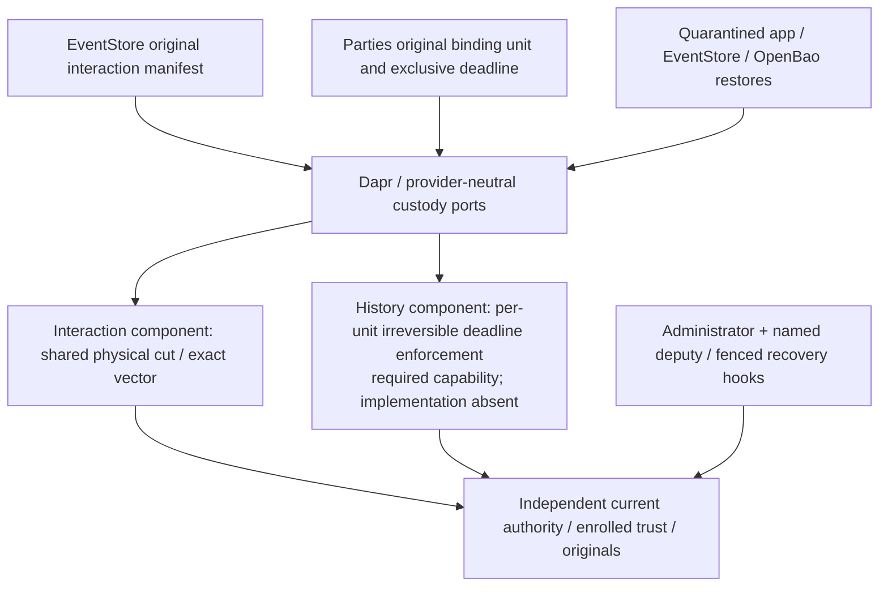

# Interaction destruction and retained human-binding custody

Created: 2026-10-18. Updated: 2026-10-22. Audience: Platform, EventStore, Parties and Agents owners resolving Story 5.4 delivery blockers.

**Recommend two separate custody classes behind Dapr: shared physical destruction for an original interaction manifest, and per-original-unit irreversible expiry for retained human-binding history. Keep production history admission blocked until exact expiry is proved.** Both use a surviving independent recovery authority. AWS remains an **unaccepted reference construction**, with no selected or qualified production backend.

This updates the existing [custody spine](../../_bmad-output/planning-artifacts/architecture/architecture-ext-protection-1-custody-2026-10-18/ARCHITECTURE-SPINE.md), retaining AD-16–AD-25 and adding AD-26–AD-28. The [October 20 decision](ext-secrets-1-erasure-authority-decision-2026-10-20.md) and [owner approval](ext-secrets-1-erasure-authority-2026-10-20/OWNER-APPROVAL.md) supersede the earlier draft's direct AWS adapter, proposed AD-9 exception and unresolved atomicity interpretation. Their detailed interaction protocol and frozen approval basis remain intact. New history mechanisms and owner alternatives below are recommendations; accepted policy is identified separately.

## Accepted choices and current blockers

| Already accepted; preserve | Consequence here |
| --- | --- |
| Dapr infrastructure abstraction; provider-neutral application ports | SDKs, native IDs and credentials stay inside replaceable infrastructure components/configuration. No new Platform AD-9 exception. A pluggable component is an extension surface, not an installed custody provider. |
| OA-1: shared physical all-or-none cut with recoverable exact-original publication | A native transaction across key and storage services is unnecessary. All-copy non-revival, holds, survivors and exact originals still require proof. Do not reopen OA-1 as an owner choice. |
| OA-3/4/5/6: one interaction physical cycle per tenant, preparation pause/sweep, original protocols, registered-copy/vendor/runtime assurance and finite retention principles | The reference profile's seven-plus-day pending interaction erase is acceptable, without a completion SLA. Actual artifacts, bounds, copy proof and numerical retention settings remain missing. |
| `party-actor-retention-v1`, purpose `party-actor-history-v1` | Retain bounded attribution independently of profile erasure; expire at original binding-effective-at plus 365 fixed 24-hour days (31,536,000 seconds). Permit only `now < ExpiresAt`. Exact cryptographic expiry includes backups and outages. |
| v21/v23 hold, dispatch, compromise and protection-reservation ordering; non-expiring revocable capability | Guard dispatch, protection-owner `ConsumptionReserved`, custody arm and final physical erasure remain distinct boundaries. No capability expiry/renewal branch. |
| Existing timing `300/30/600/86400/604800`, integration date `2026-10-08`, host `192.168.1.30`, independent approval signer | No new timeout, date, host or approval authority is chosen. The approval signing key remains outside Agents/platform-host custody; recorder and custodian cannot mint/request approval. |
| Export overlap/lifecycle policy remains Open | Affected export copies block completion until independently resolved. Export-free branches do not manufacture that decision. |
| Parent Platform AD-1/4/5/6/7/8/9/10/12/15 | Composition/build ownership, isolated identities/environments, independent erasure-safe key backups and forward-only security state remain binding. |

The [Agents register](../../../agents/_bmad-output/planning-artifacts/external-dependency-register.md) retains `EXT-SECRETS-1`, `EXT-HOST-1`, `EXT-PARTIES-1` and `EXT-CONV-AI-1` as Committed, unavailable; `EXT-PROTECTION-1` is Uncommitted. Story 5.4 was accepted as ready-for-dev; its consuming seam execution and qualification are blocked by unavailable dependencies. `OQ-5.4-1` additionally requires a Committed protection target, host verifier pass path/profile, installed inputs and anchors. `PLAT-ACTOR-HISTORY-1` is symbolic owner work, not an accepted register entry. This update changes none of those states, targets, commands or hashes.

The retained [OpenBao negative control](ext-secrets-1-option-a-feasibility-2026-10-18/README.md) observed revival after restoring a pre-delete Raft snapshot. Ordinary recoverable OpenBao/Raft cannot be the erasure authority. HMAC remains in its accepted scope.

## Two custody classes, one recovery contract

The diagram defines logical responsibilities, not a new deployed service or database. Prefer existing qualified infrastructure and owning hosts; reuse infrastructure only when both domains' isolation and failure guarantees hold. The history capability is not supplied merely by implementing `custody-lifecycle-v1` for interactions.

| Class | Destruction unit | Timing | Recoverable survivors |
| --- | --- | --- | --- |
| Interaction | Exact original same-tenant manifest of 1–1,000 complete targets | Pending until one physical cut and independently verified terminal vector; delayed completion accepted | Every non-target root, including held controls |
| Retained human binding | Original purpose-protected evidence unit and every decrypting generation/copy | Irrecoverable at its original exclusive expiry; no delayed-purge grace | Other unexpired units and successor bindings with independently valid source proof |
| Current authority / originals / public trust | Monotonic enrollment, exclusions, operation indexes and evidence | Separate retention and recovery lifecycles | Receipts and current authorization survive content-key erasure, subject to history minimization below |

Never use a profile key or an interaction epoch as the only gate for still-retained history. Never group different history deadlines under one later-lived key. Snapshot codecs must partition every copy of `HumanActorBindings` and `HumanActorTransitions.OriginalEvidence`, including typed/serialized/profile-protected forms. Mixed-root interaction snapshots remain their own integration gate.

## Remaining owner decisions

These are precise unfilled selections/inputs, not a request to reapprove OA-1–OA-6 or the 365-day policy. History Q1–Q7, continuity F1, installation/qualification F2 and D01–D04 identifiers come from the [history decision packet](ext-parties-1-platform-prerequisites-2026-10-18/decision-packet.json); `C1` below is a local coordination label, not a new register record. Each acceptance must name an accountable principal, immutable decision/profile version and evidence references. Role names alone do not fill the packet's null principal fields.

| ID and accountable owner | Recommended alternative and reviewable other choice | Exact acceptance still needed |
| --- | --- | --- |
| C1 — Platform custody owner with EventStore owner and Administrator | Qualify a supported Dapr component/provider if one meets the full interaction contract; otherwise assess the proposed semantic component with an isolated reference provider. AWS is one unaccepted candidate; reject it if proof fails. | Exact component/provider artifact and assurance profile, placement/jurisdiction, throughput/pause/latency, finite admission/completion budget and support/cost owner. Preserve Dapr; no native app fallback. This closes neither installation nor availability. |
| Q1 + Q4 — Platform history key owner and expiry/monitoring operators | Investigate autonomous expiry (H1) and refuse production admission now (H2); delayed purge (H3) needs separate explicit policy change. | Per-original-unit key hierarchy and autonomous irreversible deadline mechanism; all backup/holder coverage, trusted-time precision, power/outage bounds, escalation/retry and receipt-observation limits. No grace or early erase. |
| Q2 — Platform lifecycle/recovery owners, Administrator and named deputy | Use an existing independently operated authority if it meets survival/time/fence requirements; otherwise propose a separately placed Dapr infrastructure authority. Neither location is currently accepted. | Actual failure domain, enrolled authority/store/incarnation/trust refs, writers, witness/time source, skew/freshness bounds, fence-and-reissue owners, deputy credentials/access and total-loss stop procedure. First-release authority replacement stays unsupported. |
| Q3 — Platform recovery owner and every copy owner | Reuse qualified owner inventory/work/receipt mechanisms; if absent, propose the smallest durable Dapr mechanism rather than an in-memory fallback. | C01–C16 locations/generations or authenticated absence; copy and pending-work owners; original lookup, numeric retention/extension margins, key-backup destruction and receipt minimization. Resolve history-linkable fields with Q7. |
| Q5 — Parties domain, EventStore SDK and Platform custody owners | Prefer an authenticated domain mapping to the original binding/version/evidence; use a versioned SDK identity extension if that mapping cannot disambiguate collisions. | Establish/rebind/revoke idempotency/collision rules, trusted mapping producer, persisted exact original lookup and lost-ack behavior. Old evidence never gets revocation/rebind time as its new deadline. |
| Q6 — Platform host, Parties and EventStore integration owners | Prefer P1: version an enforced plaintext-ownership/processing boundary, then compose custody and the Parties codec into both hosts. P2 retains signatures only with full consumer-lifetime qualification. | Exact package/bootstrap/DI ownership, all seven `IIdentityHistoryCustody` methods, event/snapshot protection, current retained-source admission and complete deserialized/forwarded plaintext lifetime/zeroing/termination proof. Missing composition remains unavailable; no local-dev/no-op fallback. |
| Q7 — Parties privacy/domain owner with Platform/8.6 recovery owners and Product/Governance/Security for policy conflicts | Preserve separate history keys; prefer R1 sealed-identity plus minimal terminal-proof originals. R2 explicitly ends full original readability at expiry. Both need a versioned contract and classified non-attribution verification. | Profile versus tenant-erasure/key-backup matrix and which retained fields are still attribution; compatible original-receipt/anchor/exclusion retention format and numerical schedules. Any tenant-wide erasure conflict needs explicit owner resolution, not an inferred history exception. |
| History F1 — Parties/EventStore source-contract owners with privacy/authority owners | Approve actor-free authenticated successor continuity; otherwise retain the current fail-closed fold. | Proof producer/schema/version, scope/source positions, unique intervals/versions, currentness/epochs and erasure classification without predecessor actor/provenance/logical references. |
| History D01–D04 + F2 — deployment/identity owners, Administrator/deputy, rehearsal observers and delivery owners | Bind a real isolated installed qualification target and exact owner commands; otherwise keep Live/cohort execution blocked. | Exact environment/registry/workload/credential and renewal refs; restore cut and hooks; fault/abort/disposal bounds; accepted immutable implementation targets, integration commitments and complete P-01–P-10 evidence. Decide whether to register PLAT-ACTOR-HISTORY-1 or explicitly map that work into accepted dependency ownership; no record is added here. |

For C1, per-target irreversible deletion plus a database tombstone remains rejected because a crash can destroy a proper subset. Ordinary OpenBao restore remains rejected. A qualifying common-cut provider is the reviewable alternative to AWS; no unsupported vendor is named as a solution.

## Interaction keys: concrete construction and atomicity

Retain the adopted hierarchy: one original 32-byte interaction DEK `D`, existing tenant KEK `K(t,v)`, original AES-GCM wrapper `C0`, AAD, `KekVersion` and opaque reference. Persist **only** an outer authenticated envelope `AES-GCM-X(C0)`, with per-target random `X` protected by tenant epoch `E(t,g)`; protect the tenant KEK independently under provider-private `R(t)`. Historical `K/R` cannot recover `C0` without `X`. Never persist bare `C0`, `X`, `D` or `K`. Adding the gate today cannot repair an already retained ungated wrapper: inventory and close such copies before eligibility.

| Boundary | Concrete rule | Crash/loss interpretation |
| --- | --- | --- |
| B0 protection reserve | EventStore orders block versus `ConsumptionReserved`; retain its exact original request/reservation/capability | No replacement batch, cancellation owner or authorization |
| B1 custody reserve | One conditional current-head transition binds complete canonical vector/digest, B0 and current authenticated control; freezes whole-tenant allocation/copy/write/key acquisition | Proven no-start alone permits `NotStarted`; admitted uncertainty is `Unknown` |
| B2 prepare | Drain pre-freeze native intents, Dapr/SDK/transport holders and source writers; evacuate only non-target `X` to one independently recoverable successor | Unknown late copy/holder blocks progress; preserve the original intent |
| B3 arm | Atomically validate frozen/current comparisons and survivor coverage, adopt exact successor, and bind one source epoch for destruction | Hold/unpin/revocation changes invalidate preparation; resume survivor/new-root work exclusively under successor |
| B4 physical cut | Permanently destroy the sole remaining decrypting epoch for all selected targets | Zero-or-all target recoverability at every failure cut; per-target irreversible loops are rejected |
| B5 publish | Independent native/copy/holder/survivor/restore-barrier verification selects one immutable original ordered receipt vector | Physical completion before publication remains `Unknown`; recover original bytes, never redo destruction |

Before B3, actual permanent deletion must be proved for every other predecessor, abandoned or tainted generation that received a wrapper. Current source epoch stays live until B4; the exact adopted successor stays live for survivors and contains no selected `X`. Unknown copy destinations cannot be assumed empty. Publication merges into the current head without rewinding later survivor writes or pins. Lookup never starts a physical effect. Native send-unknown work is not resent; worker recovery follows the retained original intent and actual completion evidence.

Earlier effective or unknown pins block; governance hold registration precedes pin grants. A later post-dispatch hold cannot acquire a conflicting successful effective physical pin, including before custody receives B0; it remains restrictive elsewhere. EventStore alone owns v23 cancellation/compromise/block/re-attestation/activation. The cross-owner authenticated handoff and real holder completion are still implementation/proof gates, not new policy choices.

Use existing EventStore ordinal ordering and manifest digest bytes. A full vector commits under one head; neither target-row chunks nor paged responses split consumption. Retain exact original signature/vector bytes, permanent identity exclusions and original operation indexes. Respect the existing actor's 1,000-registration/10,000-request limits and reserve completion headroom. Dapr's pinned 4 MiB pluggable response ceiling requires the adopted authenticated original-result paging; the full legal request must also fit verified supported transport limits or the profile is rejected.

### AWS profile: conditional feasibility only

Generated single-Region KMS epochs, DynamoDB conditional head/indexes, immutable versioned S3 checkpoints and independently retained CloudTrail evidence remain one **candidate inside an infrastructure component**. No account, Region, provider artifact, application-native adapter or deployment is accepted. Paris is a historical investigation location, not an accepted jurisdiction choice.

AWS documents 7–30 days before deletion, potentially another 24 hours, and a separate actual `DeleteKey` event. Scheduling is reversible and does not destroy already released data keys. Thus the profile can only investigate delayed interaction destruction; **it cannot provide exact history expiry**. Scheduling seven days before expiry would both impede still-valid reads and leave final destruction uncertain. [KMS deletion](https://docs.aws.amazon.com/kms/latest/developerguide/deleting-keys.html), [actual deletion event](https://docs.aws.amazon.com/kms/latest/developerguide/ct-delete-key.html).

For this candidate, fixed head/index transactions select complete immutable objects; DynamoDB's 100-action/4 MiB transaction and ten-minute token cannot implement permanent idempotency or 1,000 independent atomic deletes. A native transaction does not span KMS and S3. Common physical fate plus forward original publication is the already accepted alternative. [Transaction limits](https://docs.aws.amazon.com/amazondynamodb/latest/developerguide/transaction-apis.html).

Dapr supports pluggable bindings, but the component must implement the missing custody semantics and prove transport/copy closure. A thin relay or generic secret/state/crypto calls do not qualify it. No technology upgrade is selected; the spine's existing versions remain observed baselines. Primary documentation was rechecked on 2026-10-22. [Dapr extension protocol](https://docs.dapr.io/developing-applications/develop-components/pluggable-components/develop-pluggable/).

## Human-binding history: exact expiry and alternatives

The [accepted lifecycle](actor-history-lifecycle-2026-10-07.md) and [production history contract](../../_bmad-output/specs/spec-production-actor-history-custody/lifecycle-contract.md) require two distinct facts:

1. **Authorization:** every release has current source/actor/tenant/operation authority, original evidence and authenticated time; at `now >= ExpiresAt`, deny release even if a worker has not persisted Expired.
2. **Irrecoverability:** at that same deadline, every registered source/snapshot/derived/backup/key-generation path is cryptographically unrecoverable, including during outages. A recoverable key hidden behind a denied read does not establish this fact.

Recommend a per-unit non-exportable expiry key/execution boundary whose admitted immutable deadline is enforced autonomously with trusted nonrollback time, including host/service/power loss and restore. No reusable plaintext history key may escape that qualified boundary; plaintext/runtime/Dapr buffer lifetimes also end by the deadline. All backup/recovery paths must enforce the same deadline without an administrative reset/escrow bypass. This describes a **required capability**, not a verified hardware product or installed implementation. No provider meeting it has been identified.

The current `IIdentityHistoryCustody.UnprotectEventAsync` transfers detached bytes to callers, which may deserialize or forward them; `UnprotectSnapshotAsync` returns arbitrary objects. Key non-exportability alone cannot expire those copies. **Q6 recommendation P1:** version the read/processing contract with an enforced execution and ownership boundary covering every actor-bearing buffer/object, its consumer and completion before the original deadline. A callback or disposal convention alone is not enforcement. **Alternative P2:** retain current signatures only if owners qualify the complete caller/deserializer/forwarder/snapshot graph, all actual zeroing/termination paths and deadline-spanning failures. Neither is qualified; retain production admission refusal until one qualifies. Previously exfiltrated plaintext remains outside the accepted registered-copy threat boundary, not a reason to exclude ordinary system consumers.

If authenticated time is an interval, release only when its upper bound is strictly before expiry; stale, rolled-back or deadline-straddling time denies. Exact precision, maximum uncertainty/currentness and outage behavior need Q2/Q4 acceptance and proof. Conservative denial may reduce availability; it does not authorize early physical deletion or a later expiry. Do not advertise uninterrupted reads to the last instant without a proven time model.

Destroying history and observing its receipt are separate instants. A receipt may arrive after expiry only if authentic evidence proves irreversible expiry held at the original deadline. If the backend actually deletes later, retain a breach/pending outcome; a denied `CanRead` or a successful late cleanup cannot retrospectively certify timely expiry. Preserve the library's five-second awaits and trusted-provider `ProviderConfirmedDestroyed` semantics; they do not establish independent timely-expiry qualification.

| Alternative for Q1/Q4 | Effect and recommendation |
| --- | --- |
| H1: qualify autonomous per-unit deadline enforcement behind Dapr | **Recommended direction under unchanged policy.** Prove nonrollback time, every generation/backup and actual holder closure during outages. No implementation or feasibility is assumed; reject a candidate that cannot prove the deadline. |
| H2: retain production admission refusal while no candidate qualifies | **Required current disposition.** Backend-neutral contracts and offline models can progress. Do not set `SourceExpiryEnforced`, `RestoreSafe` or `DerivedCopiesCovered` from fixtures or read denial. |
| H3: exclusive logical read cutoff plus later physical purge | Reviewable only as an explicit **policy-change alternative**, not this recommendation. Product/Governance/Security and Parties/Platform owners would have to replace the accepted hard-expiry contract, set a numerical physical-erasure bound and reaccept affected specs/commitments. No such change is authorized or applied. |

Profile erasure removes current eligibility immediately; it does not erase still-retained attribution. Rebind/revoke references to predecessor evidence keep the predecessor's original deadline. The SDK admission seam lacks an explicit binding/logical-command ID, so Q5 must choose an authenticated domain mapping or a versioned contract extension before production. Revocation time cannot silently become a new origin for old evidence. Likewise, an unexpired successor may not reuse an expired predecessor's actor-bearing proof: Parties/EventStore history F1 must define an actor-free continuation proof, or the existing strict fold continues to deny.

## Independent authority, restore and evidence retention

Use the adopted three recovery classes for interactions: `interaction-custody-authority-v1`, `interaction-custody-envelopes-v1`, `interaction-custody-originals-v1`. Map history authority, per-unit ciphertext/keys and evidence to separately scoped classes in Q2/Q3; these are recovery inventory classes, not Kubernetes StorageClasses or an instruction to provision new stores. Keep keys apart from ciphertext backups. A shared implementation is eligible only with distinct keys/scopes and all-history deadline enforcement.

The authority must survive the **whole** application/EventStore/OpenBao/host restore cut: current enrollment/incarnation, monotonic head, immutable original indexes/exclusions, revocation/fences, receipt trust and history time/deadlines. Replicas on one host or WORM archives alone provide neither independent survival nor a trustworthy current head. Administrator and the actual named deputy need independent credentials, off-site artifacts/access and notification paths; each physical/copy/fence-and-reissue owner must be recorded. Approval-signer custody remains a separate trust domain.

| Recovery step | Reopen condition |
| --- | --- |
| Fence old workload incarnation and restore in quarantine | Ordinary ingress, key release/replay, external effects and destructive workers remain disabled until owner hooks permit them |
| Contact the surviving enrolled current authority through Dapr | Restored config, old signatures, cloned tables and old private credentials cannot choose a new authority or self-enroll |
| Reconcile original units/manifests, deadlines, admitted intents and complete key/copy lineage | No new DEK, alias/version workaround, renewed history deadline or replayed unknown send; expired history backup keys are unusable |
| Independently test target and control | Erased/expired targets fail through source, snapshots and restored key backups; still-retained controls recover from the independent survivor checkpoint |
| Commit current owner recovery hooks and grant fenced replacement workload admission | Only current authority may reopen; every unknown lineage/holder/currentness result keeps quarantine closed |

First release supports the same surviving authority incarnation only. It does not support authority replacement, incarnation rollover or automatic Region/site promotion. Total authority loss/rollback/compromise fails closed. An independent witness helps verify currency; an old signed checkpoint alone cannot bootstrap a replacement. Adding authority disaster recovery later requires separately accepted architecture and qualification, preserving the parent recovery rules.

History receipts need a different minimization treatment from interaction vectors. Existing `IdentityHistoryDestructionReceipt.Unit` includes Party/evidence references and timing; opaque IDs, hashes and provenance can remain linkable attribution. They are not automatically safe forever because a DTO calls them content-free. Q3/Q7 must classify each field, design protection/minimization at admission and set retention for original receipts, key/copy journals, exclusion indexes and public trust. Actor-linkable portions expire with their original unit; only approved non-attribution verification/anti-recreation data may survive under a finite retention schedule. Do not rewrite/resign an immutable original at expiry: select a compatible envelope/receipt format or versioned contract change before admission. Interaction exact originals and public verifiers still remain available through their full referenced batch/outcome/backup lifetime; history policy does not truncate those independent obligations.

**Q3/Q7 receipt alternatives:** R1 (recommended) versions the receipt into a presealed identity segment created under the original unit's expiry protection, plus a separately signed minimal terminal proof. Post-expiry exact lookup retains the original sealed bytes/proof and an approved non-attribution proof locator; it cannot return the current DTO's plaintext `Unit`. Design the public fields, indexes and locator so the accepted privacy classification is satisfied; an opaque ID or digest alone does not prove that. R2 keeps a fully purpose-protected original whose readable lookup ends at expiry, with a versioned expired-result contract and a separate minimized proof of final destruction. Owners must accept the resulting loss of full original readability after expiry. Under both alternatives, recover a response lost at expiry from the original operation/proof; never create a new full receipt or recreate an identity key. Both require contract/profile acceptance before production; retaining the present plaintext full-unit receipt indefinitely is rejected.

## Evidence needed before handoff to implementation or qualification

Backend-neutral contract/model work may proceed under existing specs. Physical adapters/admission must wait for the relevant accepted Q/C decisions and feasibility evidence. A model proves its premises only; it supplies no installed backend, secret-buffer cleanup or vendor-internal destruction proof.

| Proof lane | Required independent persisted assertions |
| --- | --- |
| Interaction restore/atomicity | At every B0–B5 failure cut, 1/1,000 targets have zero-or-all recoverability; held/non-target controls survive. Restore pre-erasure app/config/owner/key/checkpoint copies; attempt alias/version reissue. Include alternate/tainted epochs, delayed native/Dapr sends, pin/dispatch/compromise races and response loss. Exact lookup returns original byte vector/signature and does not start work. |
| History exact boundary | Test immediately before, exactly at and after the original expiry, offset/leap arithmetic, stale/rolled-back/uncertain time, outage spanning expiry, power loss/restart and restored pre-expiry key/lifecycle backups. Prove every expired generation is unusable and no late receipt hides late physical deletion. Independently inspect state and protected key paths, not just denied APIs. |
| History identity/snapshots | Rebind/revoke and duplicate/lost-ack admission preserve the original tuple/deadline. Mixed-deadline typed/serialized snapshots cannot revive predecessor fields or destroy a live unit. Profile erasure removes eligibility without losing retained history; actor-free successor reads require accepted history F1 proof. |
| Independent authority/recovery | Old grants/config/store clones cannot self-promote; current surviving authority fences/reissues workload access. Test Administrator unavailable with the actual deputy, independent receipt verification, survivor recovery and deliberate refusal after total authority loss. |
| Evidence lifecycle | Actor-linkable receipt/anchor fields disappear on time across versions/backups, while approved minimized proof survives and interaction originals remain byte-identical for their required lifetime. Unknown inventory/holder proof prevents terminal claims. |

The existing October 20 bounded interaction-feasibility F0/F1 plan remains the immediate interaction feasibility work: offline protocol/copy vectors and Dapr/component checks. Add history time/expiry/copy counterexamples as a separate lane; passing the interaction model cannot qualify history. The existing interaction-feasibility F2/F3 resource/budget/run bounds are unchanged and require their separately scoped authorization; this documentation update performs no deployment, destructive experiment, owner Live or cohort run.

After owners select the remaining alternatives, refresh the companion specs with stable AD IDs and accepted inputs before backend construction. Installation and exact-target owner compatibility evidence then gate any register acceptance or availability transition. OQ-5.4-1 must pin Secrets and Host to the same immutable Platform commit and pass the entire ordered cohort: Phase 0 protection owner, Phase 1 host-free secrets, Phase 2 host with consumer refusal, Phase 3 mutual cases. Any failure leaves both Secrets and Host non-Available; separate phase successes cannot advance either. A reviewed architecture, receipt Boolean or successful Dapr invocation establishes none of those transitions.
