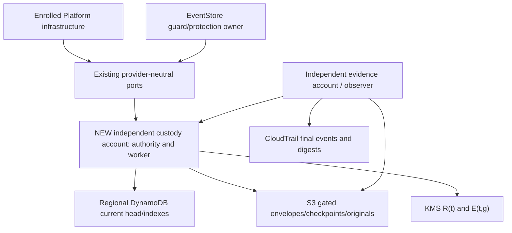

# Architecture Spine — EXT-PROTECTION-1 custody

## Design Paradigm

**Hexagonal custody boundary with a recoverable state machine.** Provider-neutral ports surround separately governed current authority and physical epoch erasure. Actors/restored application state are projections, never physical authority.

AD-16–AD-24 remain **PROPOSED**, retaining existing IDs. The [decision](../../../../docs/implementation/ext-secrets-1-erasure-authority-decision-2026-10-20.md) defines boundaries B0–B5, versions, evidence, approvals OA-1–OA-6 and experiments F0–F3. The literal native-transaction criterion remains unmet. Explicit shared-cut equivalence approval or candidate rejection precedes production binding; no contract/register/status changes here.

## Inherited Invariants

Parent IDs retain their original meaning, read-only; local decisions start after AD-15.

| Inherited | From Platform initiative spine | Binds here |
| --- | --- | --- |
| AD-1 | Composition ownership | Platform infrastructure; EventStore domain/source behavior. |
| AD-4 / AD-5 | Source/package and exact candidate | Implementation/qualification identity. |
| AD-6 / AD-7 / AD-8 | Admin, executor and environment isolation | New deployment and current enrollment. |
| AD-9 | Native-adapter exception acceptance | Administrator must accept the named custody adapter in parent spine. |
| AD-10 | Exact run ownership | Later experiments/cleanup. |
| AD-12 | Independent key custody and erasure-safe backups | Separate recovery classes and survivor recovery. |
| AD-15 | Forward-only security state | App rollback cannot roll back authority/key lifecycle. |

## Invariants & Rules

### AD-16 — Separate backend with an explicit atomicity gate [PROPOSED]

- **Binds:** provider/deployment selection, G1/G3.
- **Prevents:** backup-restorable Raft or per-target delete loops being called atomic erasure.
- **Rule:** Recommend standard AWS-generated single-Region KMS epochs, regional DynamoDB current authority and locked S3 originals in separate custody/evidence accounts, proposed eu-west-3. OpenBao stays HMAC-only. Native metadata commits B1/B3/B5 and KMS cut B4 are separate. OA-1 must explicitly accept equivalence or reject under unchanged literal criterion; no production adapter binds beforehand. New infrastructure/classes and parent AD-9 exception require OA-2.

### AD-17 — Original tenant KEK wrapper inside one erasure gate [PROPOSED]

- **Binds:** wrap/unwrap, target identity, rotation, migration.
- **Prevents:** historical KEKs/ungated wrappers reviving content or KekVersion being reinterpreted.
- **Rule:** Keep one original 32-byte D per interaction and existing AES-GCM tenant K(t,v) wrap C0/AAD/version. Protect K under generated KMS R(t). Persist only outer AES-GCM-X(C0) and X encrypted under tenant epoch E(t,g), never bare C0. Closed private envelope v1 binds full original context without changing contract fields. ReEncrypt only survivors' X to one independently verified successor before deleting E(g). Before B3 require independent actual permanent-deletion evidence for every older/abandoned/tainted generation receiving X except that exact adopted successor; scheduling/disablement is insufficient. Unknown copy closure blocks arm. No migration from historical ungated copies is inferred.

### AD-18 — Independent current authority and permanent allocation exclusions [PROPOSED]

- **Binds:** creation/reissue, enrollment, actor anchors and restore.
- **Prevents:** restored config/tables/credentials/actors becoming current authority.
- **Rule:** Independently pin account/Region, table ARN/TableId and authority incarnation outside app backups. One conditional tenant head binds complete immutable checkpoint ancestry, permanent original indexes and allocation exclusions by both target and interaction. Alias/version changes cannot reissue a root; unwrap/absence never creates one. Unknown unrecoverable unpublished allocation burns its identity. Fence old grants before replacements and reconcile admitted originals through inherited anchored transitions. Initial AuthorityEnrollmentV1 pins fixed account/Region/table ARN/TableId/incarnation in independently accepted trust. First-release authority-table replacement/incarnation rollover is unsupported; restored tables cannot self-promote and table loss fails closed until a separate architecture/qualification is accepted. Total surviving-authority loss/compromise/rollback fails closed, never bootstraps genesis.

### AD-19 — Guard dispatch, protection reserve and custody arm stay distinct [PROPOSED]

- **Binds:** hold/pin/unpin, cancel/consume and physical reservation.
- **Prevents:** ignored effective pins, retroactive cancellation or a replacement cancellation owner.
- **Rule:** Register governance hold before physical pin grant. Consume authenticated immutable guard precedence and exact B0 protection reservation at native custody admission. Earlier effective/unknown pins or unknown ordering block destruction. A later post-dispatch hold cannot acquire a conflicting successful effective pin, even before custody sees B0, and remains restrictive elsewhere. Native head CAS serializes effective pins/unpin/reserve; exact authorized release preserves other pins. EventStore alone owns v23 block/reserve/activation. Missing handoff proof denies; check-then-delete is invalid. No Product disposition changes.

### AD-20 — Shared physical cut with original-only forward recovery [PROPOSED]

- **Binds:** 1–1,000 target manifests, survivors, pending work.
- **Prevents:** partial target erasure, collateral survivor loss or replacement originals after failure.
- **Rule:** Bind exact B0/full sorted vector; CAS-freeze all tenant allocation/copy/content-write/key-acquisition admission B1–B3, drain pre-freeze native intents/producers/holders/writers, verify complete survivor checkpoint and CAS-arm one epoch. B3 atomically adopts successor as currentEpoch; only then resume survivor/new-root admission exclusively under it. Hold/unpin/revocation mutations invalidate stale preparations. No native destination may be E(g) after freeze. One physical cycle per tenant; queue B0 originals unchanged. Schedule seven-day deletion and retain Unknown until actual permanent cut/independent closure. Never delete per target. Durable worker alone resumes admitted intents; caller lookup starts no effect. Stale workers cannot publish a head. Admitted stops never become NotStarted. Native distributed atomicity remains explicitly unmet under AD-16.

### AD-21 — Actual all-copy closure precedes terminal results [PROPOSED]

- **Binds:** Destroyed/Consumed, restore barrier, observation.
- **Prevents:** schedules/disablement/missing keys/provider summaries being called irreversible.
- **Rule:** B5 needs actual final DeleteKey for exact E and all decrypting predecessors/abandoned epochs, integrity-validated original CloudTrail/signature metadata/paths/public keys, complete copy/holder closure and successful independent survivor recovery. Retain authenticated RestoreBarrierReceiptId and original vector. Vendor assurance and missing-holder termination proof are OA-4, not physical inspection. No fixed completion SLA follows from seven-day scheduling; incomplete evidence remains Unknown.

### AD-22 — Fixed native head transaction selects complete immutable originals [PROPOSED]

- **Binds:** mutation, vectors, original indexes, outcomes/coverage.
- **Prevents:** chunked manifests, forked heads, finite-token replay or regenerated receipt bytes.
- **Rule:** Prewrite/verify full objects' version/hash/retention, then fixed-count regional transaction CAS-updates head and permanent operation/event indexes. Every fact binds prior checkpoint; CAS failure recomputes. Never use 1,000 DynamoDB target actions or split manifests. Preserve exact signed/vector bytes and original batch/reservation without TTL. B5 merges into current state, never reinstalls preparation state. NotStarted requires authoritative exact absence without uncertain admission; outage is Unknown. Later coverage uses original target receipts and existing residual protocol, never changes signed membership.

### AD-23 — Preserve ports, accepted policy and trust separation [PROPOSED]

- **Binds:** adapters, runtime integration and compatibility.
- **Prevents:** backend selection weakening source contracts or policy.
- **Rule:** Preserve provider-neutral six operations, original identity/AAD/statuses/anchored transitions, v21/v23 ordering and non-expiring revocable capability. Interaction Destroy delegates to its original complete manifest. Add private batch backend/outer envelope behind unchanged consumer contracts. Preserve timing 300/30/600/86400/604800, Open overlap, host/date and independent approval signer. Occurrence use requires original encryption/write leases, current checks and actual remote completion integration. First release retains actor 1,000-registration/10,000-request hard limits, no automatic archive/shard/eviction. Reserve completion capacity before admission and fail closed before exhaustion; F1 must measure that finite budget. Never drop physical originals/allocation exclusions. Separately encrypted export/partial/key/backup paths need their own accepted closure; Open/unqualified export policy blocks all-copy B5 for affected targets. Export-free branches remain eligible. Other history/qualification obligations remain separate.

### AD-24 — Every copy and holder joins closure before effect [PROPOSED]

- **Binds:** storage/recovery, diagnostics, copies, operators and key-use.
- **Prevents:** late buffers, bare wrappers or alternate key paths reviving content.
- **Rule:** Register actual copy/generation/holder identity/location/owner/lineage/retention/exact outcome before effect. Include source/target/snapshot/cache/workflow/broker/export/partial/backup, DB logs/restores, S3 versions, KMS generations and SDK/TLS/runtime memory. Persist only gated wrappers/encrypted keys. Disable swap/core/hibernation/memory capture; require authenticated completion/zeroing or accepted termination proof. Lease expiry alone is not erasure. Only the selected private native-key broker has native key-use permissions; workers/callers/recovery have none. Durable NativeIntentV1 commits one send, disables SDK/HTTP retries and redirects, and closes only after result persistence plus actual I/O/buffer completion. Never replay send-unknown intents. B3 requires all pre-freeze producer incarnations drained or independently terminated. Taint unknown staging destinations and permanently delete them before arm; an unknown current/adopted destination blocks qualification. KMS eventual consistency/grant revocation alone never fences native effects. Direct decrypt/rewrap bypass and policy drift invalidate closure. Unknown copies/holders block B5. Receipt encryption/public trust retention are independent of E under OA-6.

## Stack

| Name | Version |
| --- | --- |
| Existing OpenBao / Dapr | 2.6.2 / 1.18.1 |
| Build SDK / proposed self-contained runtime | 10.0.402 / 10.0.13 |
| KMS / DynamoDB APIs | 2014-11-01 / 2012-08-10 |
| S3 / CloudTrail APIs | 2006-03-01 / 2013-11-01 |
| AWSSDK.KeyManagementService / DynamoDBv2 | 4.0.100.19 / 4.0.108 |
| AWSSDK.S3 / CloudTrail | 4.0.104.5 / 4.0.101.7 |
| Proposed private protocol/outer format | custody-epoch-v1 |

Managed binaries are vendor-owned. SDK compatibility, new service image/AMI and actual cloud resources remain unqualified build/provisioning outputs. Exact observations/source bindings live with the decision.

## Structural Seed

Two private control instances occupy distinct AWS AZs outside the single-node application cluster. Current authority, encrypted envelopes and originals have separately inventoried recovery classes, not new Kubernetes StorageClasses. Ordinary app/OpenBao/Velero recovery cannot promote current authority. This deployment/native exception is unapproved.

## Capability → Architecture Map

| Capability | Owner | Decisions |
| --- | --- | --- |
| Stable root/tenant KEK | Platform private adapter | AD-17 / AD-18 / AD-23 |
| Hold/dispatch/block/reserve | Guard, protection owner, custody head respectively | AD-19 |
| Atomic vector/original outcome | Epoch plus independent head/original store | AD-16 / AD-20 / AD-21 / AD-22 |
| Rotation/restart/restore | Independent authority/copy owners | AD-17 / AD-18 / AD-24 |
| Qualification/availability | Independent owners and accepted joint cohort | AD-16 / AD-21 / AD-23 |

## Deferred

- **Blocking OA-1–OA-6:** atomicity equivalence or reject; deployment/classes/AD-9; latency/Regional-loss operating envelope; vendor/copy/memory assurance; adoption of specified guard/envelope/native-intent/lease integration; full-lifetime retention. Proposed decisions authorize none of these. OA-1 rejection returns to backend selection.
- **F0–F3 before binding:** offline model, criterion/SDK/maximum-vector fit, separately authorized native erasure/restore and recovery/ordering faults. None run here.
- **Provisioning outputs after approval:** actual account/table/keys/buckets/AMI/image IDs, public anchors and private credential references with current permission/denial proofs. Do not invent installation references.
- **Other Story 5.4 prerequisites:** profiles/signers/replay/compromise/export delivery, real qualification roles, protection commitment/shared target/host profile/joint runner. This slice neither changes export Product policy nor qualifies actor-history custody, edits the register or establishes Available.
