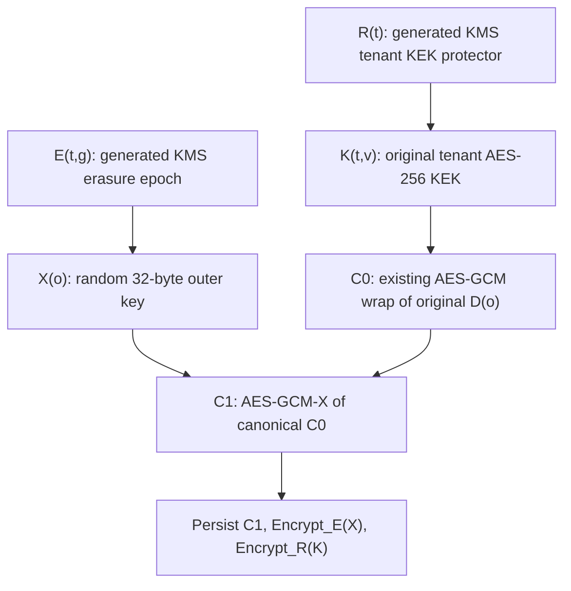

# EXT-SECRETS-1 erasure authority and lifecycle backend decision

2026-10-20 • Platform/security/operations owners and Agents Story 5.4 implementers • reviewed baseline `ad1c770d680f70af3a9638306635ba514426ef36`.

**Recommendation complete; adoption and feasibility unapproved. EXT-SECRETS-1 remains Committed and unavailable.** No infrastructure, destructive experiment, owner qualification or register change follows from this document.

## Recommendation and decisive limit

Recommend a **hexagonal custody service with a recoverable state machine**: standard AWS-generated single-Region KMS tenant erasure epochs, independently governed DynamoDB current lifecycle/fencing authority, and versioned S3 Object Lock checkpoints/original outcomes. Propose Paris `eu-west-3`, a dedicated custody account and separate evidence account. Keep OpenBao in its existing HMAC scope; reject ordinary Raft recovery as erasure authority.

**This construction does not satisfy the existing literal native-transaction criterion.** Native metadata transactions, a shared physical KMS deletion and original receipt publication are separate boundaries. No verified primitive spans all three. The proposed shared-cut/recoverable-outcome equivalence requires explicit contract-owner approval; it is not inferred here. If validation, physical erasure and durable receipts must share one native transaction, reject this candidate. No qualifying backend was established under that unchanged criterion. Do not enable a production adapter while it remains binding.

This resolves the recommended construction and makes the surviving approval precise; it does not claim that the blocker is closed. It supersedes the recommendation/hierarchy in the [2026-10-18 design](ext-protection-1-custody-design-2026-10-18.md), preserving its historical evidence. The updated [spine](../../_bmad-output/planning-artifacts/architecture/architecture-ext-protection-1-custody-2026-10-18/ARCHITECTURE-SPINE.md) retains AD-16–AD-23 and adds AD-24. All remain proposed.

## Exact owner approvals and provisioning returns

| ID / owner | Required decision |
| --- | --- |
| **OA-1 — Architecture, EventStore/protection contract owners** | Accept distributed shared-cut/recoverable-outcome equivalence with explicit native-criterion change, **or retain literal criterion and reject backend**. No implicit contract relaxation or register edit. |
| **OA-2 — Administrator/Platform architecture/security** | Approve dedicated custody/evidence accounts, Paris/two-AZ/private deployment, new recovery classes, isolation/enrollment and named parent AD-9 native-adapter exception. |
| **OA-3 — Product/lifecycle + operations** | Accept 7+ day pending interval, one tenant cycle/O(N) sweep, whole-tenant preparation pause, conservative actor limits and Regional/table-loss fail-closed envelope with no first-release authority-table replacement; supply N/rates/budget/capacity/incident coverage. No new hold/export policy chosen. |
| **OA-4 — Security/copy owners + independent observer** | Accept documented vendor-internal-copy assurance and trusted-runtime boundary; approve actual copy graph/no-bare-C0 ancestry and SDK/TLS/buffer/unknown-holder proof. If unattainable, reject guarantee. |
| **OA-5 — Platform/EventStore maintainers** | Adopt specified private outer encoding/AAD vectors, proof/native-broker protocol, generation-loss/burn rule, authority enrollment and key-use completion protocol while preserving public contracts. |
| **OA-6 — Governance/privacy/security/recovery** | Approve finite retention/extension/minimization covering every referenced batch/backup for checkpoints, outcomes, public trust and allocation exclusions. No short TTL/reset to retry. |

After these decisions, cloud owner returns actual account IDs; table ARN/TableId/PITR/deletion protection and initial AuthorityEnrollmentV1 public record/digest; bucket ARN/version/retention/copy proofs; CloudTrail event selectors/integrity; key ARN/origin/spec/policies; private network/AMI/service-image identities and host controls; mounted **credential references**, current enrollment/least-privilege and direct-bypass denial evidence. No secret values or private keys belong in the return packet.

Lifecycle/protection owners return actual `allCopyLifecycleAuthorityReference`, `allCopyInventoryReference`, `nonrollbackJournalReference`, `restoreTarget`, `protectionOwnerReference` and public proof anchors only after implementation/installation. Preserve all other named INPUTS.md requirements; this decision fills none with speculative strings. Later Agents acceptance requires immutable shared target/configuration/234-case plan/anchors, host profile and actual joint runner. Existing accepted `abbec409...` and null anchors remain unchanged. Architecture approval is not deployment, qualification or Available.

## Assurance classification

**Verified:** exact reviewed source/interfaces, historical Raft revival, fresh selected single-node metadata, primary provider capability/limit documentation and public package/local runtime versions.

**Inferred design properties:** sole-epoch X deletion cuts every fully gated target path while survivors retain a path; independent head/allocation exclusions fence app rollback/reissue; immutable objects/conditional heads recover exact originals. These require model/native proof.

**Unproved:** native cross-service transaction; cloud installation/permissions/quota, proposed SDK build/image, private vendor-media erasure beyond documentation, whole SDK/TLS/host-memory cleanup, actual guard handoff and complete production copy/original/restore recovery. OA-1 may reject the construction. Strings, tombstones, signed fixtures and unaccepted Live runs close none of these gaps.

## Investigation and verified primitives

Inputs: [HANDOFF.md](/home/administrator/hexalith-secrets-evidence/ext-secrets-1/completion-20261019/HANDOFF.md), [INPUTS.md](ext-secrets-1-completion-2026-10-19/INPUTS.md), [provider decision](ext-secrets-1-dek-provider-decision-2026-10-18.md), existing Platform custody interfaces, and Agents EXT-SECRETS-1/EXT-PROTECTION-1/v21/v23/OQ-5.4-1 contracts. [Source bindings](ext-secrets-1-erasure-authority-2026-10-20/source-bindings.json) hash exact bytes and distinguish the candidate EventStore gitlink from inspected sibling source. No sibling revision is inferred accepted.

Fresh [selected Kubernetes metadata](ext-secrets-1-erasure-authority-2026-10-20/infrastructure-observation.json) reports **one node**, kubelet `v1.34.9`, Ubuntu `24.04.3 LTS`; local OpenEBS hostpath classes with Delete/Retain; OpenBao `2.6.2` with three ready replicas; Dapr `1.18.1`; PostgreSQL `18.6-trixie`, CloudNativePG `1.30.0` and Barman plugin `0.15.0`. Three replicas on one node do not establish independent host/site survival. Only selected public metadata was read, without Secret/config/key values or owner effects. This metadata snapshot does not qualify service health. No AWS account, deployment, quota or entitlement was inspected or established.

| Candidate/primitive | Supported fact and decision |
| --- | --- |
| Ordinary OpenBao/Raft, even a custom engine/mount | Retained native negative control **observed revival** after pre-delete snapshot restore. Plugin storage transactions do not remove snapshot history. Reject for erasure. [Negative-control evidence](ext-secrets-1-option-a-feasibility-2026-10-18/README.md), [transaction design](https://openbao.org/community/rfcs/transactions/). |
| PostgreSQL/Redis/local storage | Transactions can order metadata; deleting rows/files does not establish erasure of logs/backups or independent survival. No destructive qualification performed. |
| Standard KMS generated symmetric single-Region key | Final whole-key deletion is documented irreversible; scheduling/disablement are reversible. Select as physical primitive, subject to vendor assurance. Custom-store backups, imported material and multi-Region replicas require additional closure and are excluded. [KMS deletion](https://docs.aws.amazon.com/kms/latest/developerguide/deleting-keys.html), [import/reimport](https://docs.aws.amazon.com/kms/latest/developerguide/importing-keys-import-key-material.html). |
| Per-target KMS deletion loop | Separate physical effects cannot provide one arbitrary 1–1,000 target cut; reject. |
| DynamoDB transaction | 100 actions, aggregate 4 MB, 400 KB item ceiling; no KMS participation. Use a fixed-count head/index transaction referencing whole immutable vectors, never target-item chunking. Its ten-minute token is not permanent idempotency. [Native transaction limits](https://docs.aws.amazon.com/amazondynamodb/latest/APIReference/API_TransactWriteItems.html). |
| S3 Object Lock / CloudTrail | Durable retention and evidence integrity; neither establishes current ordering or physical vendor-media inspection. [Object Lock](https://docs.aws.amazon.com/AmazonS3/latest/userguide/object-lock.html), [CloudTrail validation](https://docs.aws.amazon.com/awscloudtrail/latest/userguide/cloudtrail-log-file-validation-intro.html). |

## Exact components and new deployment/storage classes

These are feasibility pins, not an installed bill of materials. Managed-service binaries cannot be customer-pinned; bind their APIs and actual resource identities. [Public version observations](ext-secrets-1-erasure-authority-2026-10-20/version-observation.json) retain publisher feeds and local runtime checks.

| Component | Version/binding |
| --- | --- |
| Existing OpenBao | `2.6.2`, digest `sha256:11fd73a2102cda9c55d5d881a8c3210303146a7ec1e8ac76f526e175c6d24641`; HMAC scope unchanged. |
| Existing Dapr | `1.18.1`; existing caller boundary, not the new native backend. |
| New Platform custody authority + durable worker | Source SDK `10.0.402`; proposed self-contained ASP.NET/Core `10.0.13`; private protocol `custody-epoch-v1`. Published versions verified; the new service is unimplemented. |
| KMS | API `2014-11-01`; `SYMMETRIC_DEFAULT`, `ENCRYPT_DECRYPT`, `Origin=AWS_KMS`, `MultiRegion=false`, standard store. |
| DynamoDB | API `2012-08-10`; one regional authority table, conditional transactions/strong reads, no original-record TTL. |
| S3 / CloudTrail | APIs `2006-03-01` / `2013-11-01`; versioned compliance-locked objects; KMS management events and log integrity enabled. |
| New native adapter packages | `AWSSDK.KeyManagementService 4.0.100.19`, `AWSSDK.DynamoDBv2 4.0.108`, `AWSSDK.S3 4.0.104.5`, `AWSSDK.CloudTrail 4.0.101.7`; publisher versions checked, graph/build compatibility untested. |

Primary API references: [KMS](https://docs.aws.amazon.com/kms/latest/APIReference/Welcome.html), [DynamoDB](https://docs.aws.amazon.com/amazondynamodb/latest/APIReference/Welcome.html), [S3](https://docs.aws.amazon.com/AmazonS3/latest/API/Welcome.html), [CloudTrail](https://docs.aws.amazon.com/awscloudtrail/latest/APIReference/Welcome.html); [.NET family support](https://learn.microsoft.com/en-us/lifecycle/products/microsoft-net-and-net-core). Freeze a package lockfile and immutable build/image digest before acceptance. There is no new compiled service/image to pin yet.

**New deployment:** two private Linux x64 custody control instances in distinct Paris AWS availability zones, outside the application cluster and its administrators/executors' credentials. Recommend hardened Ubuntu 24.04 EC2 images; exact AMI IDs and service image digests are provisioning/build outputs, not fabricated here. Private authenticated ingress admits enrolled infrastructure callers only. Disable swap, cores, hibernation and process/VM-memory capture; do not take running key-handler machine images. Use Platform release ownership, no additional orchestration framework. A separately administered evidence account retains originals and audit copies; observers have no decrypt/delete authority. Separate staging/production resources, enrollment and trust.

**New recovery classes:** `interaction-custody-authority-v1` (forward-only current metadata), `interaction-custody-envelopes-v1` (gated encrypted keys/checkpoints), `interaction-custody-originals-v1` (retained outcomes/public trust). These inventory classes are **not Kubernetes StorageClass objects**. Neither local OpenEBS class is qualified for this guarantee. Exclude current authority/key custody from ordinary app, Velero, OpenBao and DB restore. Receipt-storage encryption has its own retained keys, never tenant erasure epochs. OA-2 must approve deployment/classes and the parent Platform AD-9 native-adapter exception.

## Key hierarchy: preserve the existing tenant KEK contract

For target `o=(TenantId, AgentInteractionId, TargetProtectionKeyAlias)`:

Keep the single original 32-byte DEK `D(o)` and `CustodyKeyWrapCore` unchanged: original tenant `KekVersion`, nonce/tag lengths, `candidate-custody-key-wrap-v1` AAD and complete identity/purpose/lifecycle/store/contract. Genuine per-tenant KEK generations `K(t,v)` are encrypted under separate generated KMS protector `R(t)`.

The provider-private outer envelope `C1=AEAD_X(canonical(C0),outerAAD)` adds erasure isolation without calling an object-specific key a tenant KEK. Closed outer format v1 authenticates full original identity, KekVersion, format, original opaque object identity and outer-key generation. Current epoch ARN/encrypted-X hash are separately authenticated by the immutable checkpoint. Survivor epoch rewrapping changes that metadata, not C0, its KEK version or the opaque root identity. Freeze exact canonical encoding/golden vectors before implementation.

**Persist no bare C0, X, D or K.** Only gated C1 and encrypted X/K may enter backups. A historical bare C0 plus surviving K bypasses this design. Adding an outer layer to today's copy cannot repair an old ungated backup; such migration requires separate complete closure proof. No installed production DEK provider was established, so no migration is claimed.

For manifest M, freeze tenant epoch g, reencrypt every **non-target** X to one successor `E(t,g+1)`, and verify an independent survivor checkpoint before arm. [KMS ReEncrypt](https://docs.aws.amazon.com/kms/latest/APIReference/API_ReEncrypt.html) keeps plaintext within KMS. Never reencrypt selected X into a surviving key. Every older epoch must already be permanently deleted before another physical cycle. Register every candidate/abandoned generation that receives any X. Before B3, independently verify **actual permanent deletion** of every alternate decrypting predecessor/abandoned/tainted epoch, including numerically newer abandoned candidates; scheduling or disablement is insufficient. The exact adopted successor is the only live exception. Unknown copy attempts block arm.

After actual deletion of E(g), M loses its sole remaining X path at one shared physical cut while survivors retain theirs. Historical K/R does not recover C0 from C1. **This is an inference conditional on complete copies and genuine permanent deletion, not an observed backend guarantee or native distributed transaction.**

Permanent allocation indexes both full target and interaction: changing alias/version/store cannot allocate another root for an admitted/erased interaction. Unwrap or missing-key recovery never generates roots. Reserve original allocation before generation; release no key before its encrypted original is durable. Lost generation/publication stays Unknown. If an unpublished original cannot be recovered, burn that identity rather than regenerate it. Record/clean every transient generation attempt; no surviving deterministic master may derive erased D/X again.

## Authority model and transactions

One tenant head binds authority incarnation, monotonic revision, full immutable checkpoint version/hash, current epoch, pending original and fence/lease state. Its checkpoint owns registrations, complete allocation exclusions/target index, pins/unknown restrictive state, copy/key-generation graph, admitted owner reservations, originals and exact actor-anchor transitions. No key bytes or bare C0 enter DynamoDB.

Prewrite/verify immutable request/checkpoint objects and retention, then one regional transaction conditionally updates the prior head and creates immutable operation/event indexes. All validated facts bind the prior checkpoint hash. On compare-and-swap (CAS) failure, recompute the proposed checkpoint from the current state. Every hold, allocation, copy, key-use and erasure mutation follows this head. A fixed small action count references full 1,000-target vectors in S3; do not put those actions/items in DynamoDB or split the manifest. Parsing/transport byte bounds must be measured against the maximum legal contract fields. Original indexes have no TTL. Orphan objects do not become current by existence alone.

| Boundary | Preconditions/effect | Failure recovery |
| --- | --- | --- |
| B0 — protection reservation | EventStore alone orders block/reserve and returns original `ConsumptionReserved` | Exact owner lookup; never replace batch/capability/reservation. |
| B1 — native custody reserve | Authenticate B0/request; validate exact sorted vector/digest/revisions/guard order, no effective/unknown pins; CAS freezes M and all tenant allocation/copy/write/key-acquisition admission | No physical target erasure yet. Recover admitted original; post-admission stop is Unknown. |
| B2 — survivor preparation | Drain all pre-freeze native intents/producers/writers/holders; move survivors only into a fresh staging epoch; verify complete independent checkpoint and actual retirement of all alternate epochs | Resume preparation, no irreversible receipt. Target access/new copies deny. |
| B3 — native arm | CAS exact original, full vector, closed producers/holders, actual alternate-epoch deletion and no conflicting pin; **atomically adopt successor as currentEpoch** | Monotonic intent owns that epoch; no replacement batch/cycle. |
| B4 — KMS physical cut | Durable worker schedules exact armed E with seven-day wait, observes actual permanent deletion | Separate native service effect. Disable/schedule/cancel/not-found/outage remains Unknown; reconcile lost response against the same key/intent. |
| B5 — native terminal publication | Independent observer verifies native final event, complete closure, survivor recovery/restore barrier; prewrite vector then CAS exact result | Merge into current state, preserving intervening survivor writes; recover the one original selected receipt/vector bytes. |

Between B1 and B3, pause whole-tenant root acquisition, allocation and content/copy writes; drain effects admitted before freeze. Registered hold/unpin/revocation facts still mutate the same head and invalidate stale preparation/arm comparisons. B3 alone resumes survivor/new-target admission, exclusively under adopted E(g+1); selected targets remain fenced. No Encrypt/GenerateDataKey/ReEncrypt destination may be E(g) after freeze. This deliberate tenant pause is part of OA-3.

B4 is the common physical cut; B1/B3/B5 are metadata transactions. There is no native transaction across them. Persist exact signed outcome bytes before publication; do not regenerate signatures, times or receipt IDs on lookup. Uncommitted candidates may remain retained but only the head-selected object is original.

Preserve existing `NotStarted/Consumed/Unknown` and custody statuses. NotStarted requires authoritative exact no-admission proof with no uncertain outstanding start; outage/not-found is not proof. Consumed returns the complete ordered `DeletionTargetReceipt(Target,OriginalBatchId,ReceiptId)` vector only. All admitted pending states remain Unknown. Lookup is authenticated and read-only; a separate durable worker continues admitted intents after crash/loss, never a caller lookup effect. Keep the actor's 30-second operational budget; days of pending work do not become a blocking actor call. Entirely covered targets need no B4 effect. A mixed covered/live cohort cannot enter B1 unless the existing EventStore original-coverage protocol supplies a valid residual reservation; return authenticated original-batch coverage or refuse. Never alter submitted signed membership or combine unrelated receipts into a new atomic outcome.

### Native-key broker and late-request closure

Select one **private native-key broker boundary** inside the new custody control deployment. Only its separately scoped current workload identity receives KMS Encrypt/Decrypt/ReEncrypt/key-generation permissions. Admission/worker/caller/restore identities receive no direct key-use or rewrap grants. Broker credentials are unavailable to general service composition and worker code; provisioning must demonstrate that isolation on the actual instances. The broker uses the same pinned authority; it has no independently restorable local admission journal.

Before native submission, atomically register `NativeIntentV1(TenantId, OperationId, IntentId, RequestDigest, BrokerIncarnation, SourceKeyArn, DestinationKeyArn, TargetDigest, ExpectedHeadRevision, Phase)`. `Phase` advances `Prepared → SendCommitted → ResultDurable → Closed`, with `SendUnknown` retained after loss. SendCommitted permits **one send only** by that incarnation; restart never resumes a send-unknown intent. Disable SDK retries and HTTP retries/redirects for native generation/copy effects. Persist exact result/object hash, await every I/O task and zero owned request/response buffers before authenticated Closed. Native scheduling recovery uses the original armed key/intent; it is never a new destructive identity.

B3 requires no open pre-freeze native intent, no unacknowledged producer incarnation, and actual buffer/I/O completion or accepted host-termination proof. A stale worker losing a head lease does not prove an old broker stopped. Native KMS grants/state propagation are eventually consistent; do not use revocation, sleep, one DescribeKey or network fencing alone as completion proof. [KMS consistency](https://docs.aws.amazon.com/kms/latest/developerguide/accessing-kms.html).

An unknown survivor-copy result **taints its destination staging epoch**. Never adopt it: drain/terminate that broker incarnation, permanently delete the tainted destination and retain final evidence before B3. Keep E(g) live while verified survivors are staged into a fresh, fully tracked candidate. Internal preparation attempts remain children of the same original manifest; no public batch/root/receipt identity changes. If a possible late copy targets E(g), an adopted live epoch or any unbounded/unidentified destination, no safe cleanup is inferred: remain Unknown and reject qualification. No receipt or independent survivor-backup claim follows from an unknown copy. Physical/runtime feasibility of this strict protocol remains OA-4/F2/F3 proof, not a supplied implementation.

### Private protocol fields and first-release bounds

Freeze these version-1 shared fields before downstream units build independently:

- `OuterEnvelopeV1`: complete existing Identity, original KekVersion, original OpaqueWrappedKeyReference, OuterKeyGeneration, 12-byte nonce, ciphertext and 16-byte tag. Inner C0 uses RFC8785 canonical JSON with closed `Identity`, `KekVersion`, `Nonce`, `Ciphertext`, `Tag` fields and unpadded base64url byte fields. Identity uses the exact existing property names and string values, with Purpose encoded as its case-sensitive enum name; no Unicode normalization. Allocate the stable opaque reference before encryption; it cannot depend on the resulting C1 hash. Outer AAD uses existing PlatformCanonicalBytes.Components in order: `custody-epoch-outer-v1`, TenantId, ObjectId, Purpose.ToString(), KeyAlias, KeyVersion, LifecycleVersion, StoreTarget, ContractVersion, KekVersion, OpaqueWrappedKeyReference, OuterKeyGeneration. Current epoch/encrypted-X references live in the checkpoint, outside immutable C1/AAD.
- `ControlAdmissionProofV1`: issuer/audience/proof ID, authority incarnation, TenantId, full target-vector digest, action, HoldId and registered/release guard revision/receipt when applicable, exact dispatch revision/receipt when applicable, original protection ReservationReceiptId for destruction, DecisionVersion, expected custody revision/checkpoint hash and proof signature. The container carries guard and protection receipts authenticated by their source owners; its assembler cannot mint ordering authority. Independently verify each owner receipt and current enrollment/revocation. No proof changes guard ordering or substitutes for live current revocation. Bind proof bytes by digest in the native original.
- `CustodyCheckpointV1`: authority/incarnation/tenant/revision/predecessor digest, current/staging/tainted epoch inventory, complete sorted registrations/allocation exclusions/pins/restrictive intents/copy graph/key-use/native intents, immutable owner-original/receipt indexes and admitted actor-anchor transitions. Use full immutable canonical snapshots initially; no unspecified independently committed per-target shard. The small native head selects S3 key/version/SHA256 plus current epoch and pending original. Operation/event indexes bind the same head ancestry.

The first release **keeps existing hard limits**: at most 1,000 admitted root registrations and 10,000 retained lifecycle requests per tenant projection, with no automatic archive, eviction, tenant sharding or increased limit. Permanent physical-authority originals/allocation exclusions are never dropped. Admission reserves bounded completion capacity before starting work and fails closed before exhaustion; already admitted originals retain recovery capacity. F1 must measure actual per-original transition/request headroom and specify its finite admission budget; if that cannot fit, production implementation stops rather than promising archival later. A successful 1,000-target backend test does not qualify an actor with 1,001 registered roots. Use a small same-tenant survivor/held-control lane and a separate 1,000-target lane within the two synthetic tenants; preserve their original identities throughout.

## Hold ordering, capability revocation and accepted policy

Preserve `L/S/O/H/R=300/30/600/86400/604800`, integration date `2026-10-08`, host `192.168.1.30`, overlapping-export disposition **Open**, non-expiring revocable capability, sole active attestation and separate independent decision-approval issuer. This does not choose a Product hold/export policy or qualify export/actor-history custody.

Three different owners/instants remain: guard dispatch orders governance holds; EventStore ConsumptionReserved orders post-dispatch cancellation/compromise; custody arm fixes the physical epoch. Do not transfer cancellation authority to arm.

Propose an authenticated private handoff binding tenant/complete target digest, exact registered HoldId/release or dispatch receipt/revision, DecisionVersion, expected custody head/incarnation, and B0 reservation for destruction. Agree the closed proof schema with EventStore before implementation:

1. Governance hold registration precedes any physical pin grant. An earlier registered hold blocks dispatch even if pin acknowledgement is lost; unknown restrictive order blocks custody reserve/arm. Earlier effective physical pins block standalone and manifest destruction.
2. A later post-dispatch hold cannot obtain a conflicting **successful effective physical pin** for this batch, even before custody receives B0. Consume current immutable guard ordering at pin admission; report pending/denied using existing statuses, never Pinned followed by erase. The hold stays restrictive for other batches, cleanup and completion as v21 requires.
3. Native head CAS serializes pin/unpin/reserve. Unpin consumes only the exact authorized same-hold release, preserving other pins and its original outcome. Check-then-delete is invalid.
4. EventStore retains v23 block/reserve/activation and replacement-key block-set revision checks. A block winning before B0 prevents effects. B0 winning requires same-original recovery; revocation/rotation/restart cannot create a replacement destructive identity.

This is an unimplemented protocol, not a verified handoff. If actual guard facts cannot establish immutable precedence without a race, stop B1. Architecture approval cannot substitute for native ordering proof.

## Complete copy inventory

Name actual location/resource, owner, copy operation/outcome, retention, key lineage, holder incarnation and closure evidence. Unknown inventory blocks B5. Authentication refusal alone is insufficient; retained controls must still decrypt.

| Copy/recovery path | Required treatment |
| --- | --- |
| Source outbox, target events, snapshots, caches/read models, Workflow/Dapr state, brokers/DLQs, temporary files and their backups | Same original interaction root and every occurrence inventoried; no independent plaintext/root copy. |
| Separately encrypted exports, partial outputs, manifests, indexes, export-key wraps and backups | Independent decrypting paths under the export-envelope key, not this interaction DEK. Require their own accepted complete lifecycle closure under the phase-pinned policy. Open/unqualified export lifecycle blocks B5 for any affected target; genuinely export-free targets may proceed. No export keys are reinterpreted as root keys. |
| Bare C0; X/D/K, plaintext buffers, SDK/TLS copies | Never persist ungated material. Track bounded key-use/completion and actual zeroing. Swap/core/hibernation/memory snapshots, untracked caches and diagnostics disqualify closure. |
| S3 object versions, independent copies, exports/backups | C1/encrypted-X/K only; inventory every historical/current/abandoned decrypting epoch and copy attempt. Only actual epoch deletion removes retained wrapper paths. |
| DynamoDB replicas/logs/PITR/backups/streams/restored clones | Value-free lifecycle metadata only, no plaintext keys/C0. Current authority uses strong table reads; no GSI/stream/cache authority. Restored tables quarantine. [Read consistency](https://docs.aws.amazon.com/amazondynamodb/latest/developerguide/HowItWorks.ReadConsistency.html), [restore creates new table](https://docs.aws.amazon.com/amazondynamodb/latest/developerguide/pointintimerecovery_restores.html). |
| KMS internal/backing copies | Standard generated whole-key deletion is accepted vendor boundary; no import escrow/custom stores/replicas. Public APIs cannot independently inspect every vendor physical copy. |
| Late RPCs, dead/restarted callers/workers and owned buffers | Current lease/check before release/commit, authenticated completion/zeroing, or independently accepted termination/isolation proof. Timeout, cancellation and lease expiry alone never prove zeroing; unknown holder blocks receipt. |
| Logs/traces/metrics/proxies/support dumps | Content-free references; never C0, keys, payloads or credentials. Encryption contexts use opaque digests. Audit interception/middleware too. |
| Old config, receipts/owner state, credentials and public trust | Independently enrolled live authority/incarnation/current revocation governs access; permanent interaction index prohibits reissue. Historical public verifiers do not grant new effects. |
| Operator/break-glass/recovery/decrypt/rewrap paths | No application/recovery grant bypasses custody to move X to a surviving key. Policy drift stops attestation until complete reconciliation. |
| Original outcomes, public anchors, CloudTrail log/digest objects/signature metadata | Retained outside tenant-erasure encryption through full referenced batch/backup lifetime. Metadata access/minimization still needs policy. |

Every new content/key-bearing copy class, generation or export permission is a registered custody transition **before effect**, including lost copy acknowledgements. No selected-target copy may be admitted after freeze. No guarantee covers previously exfiltrated plaintext or simultaneous compromise/rollback of all independent custodians/provider. The registered-system-copy and surviving-authority boundary needs OA-4 acceptance.

## Rotation, restart, restore and failure domains

Tenant KEK rotation creates K(t,v+1) for new wraps; old C0 retains original version/AAD. Rotate R through registered KEK-envelope operations. Neither reissues D/X. Move E only through complete epoch protocol. HMAC/digest/signing families remain separate; retain historical public capability verifiers for the full batch lifetime, and use existing v23 emergency block/re-attestation. Approval private keys remain outside this service.

Restart authenticates current enrollment, strong head/object hashes and exact admitted originals. Fence old instance grants before replacements; reconcile pending generation/copy/holder/KMS effects. Worker ownership transfer continues the same original. Stale workers cannot publish a head; already-sent native requests must still be reconciled. Credential revocation does not erase delivered memory.

Application/OpenBao/DB restore starts quarantined. Independently load account/Region, table ARN **and TableId**, authority incarnation and current enrollment/revocation from outside the restored set. Reconcile actors through inherited `IAnchoredStateTransitionAuthority`, not legacy RecordRevision alone. Resolve opaque roots against live custody; typed Erased requires the independently verified original RestoreBarrierReceiptId. Missing keys never suffice. Survivors recover from independent current checkpoints, not old application copies of authority.

**First-release authority-table replacement is unsupported and fails closed.** Initial owner enrollment pins a public `AuthorityEnrollmentV1` record (account, Region, table ARN/TableId, fixed authority incarnation, service trust identity and record digest) in the independently accepted deployment/trust packet outside all app recovery sets. Normal service restart/app restore uses that same surviving table; no restored table, old config, new TableId or new authority incarnation can enroll online. A backup cannot prove no later commit. Replacement requires a separate accepted current-enrollment/reconciliation architecture and qualification; it is not an operator bypass supplied here. Loss/rollback of all surviving current evidence fails closed, including root creation; no new genesis. Deleted E still prevents historic ciphertext recovery, but this excluded failure provides no survivor-availability or original-outcome-recovery guarantee.

| Failure domain | Consequence |
| --- | --- |
| Existing single-node application cluster/local PV | App outage/restore; independent custody survives if deployed as proposed. Existing replicas give no site independence. |
| One custody instance/AZ | Replace/fence/recover original through shared regional authority; availability requires native tests. |
| Custody Region/account unavailable | Deny release/effects, retain Unknown. No automatic cross-Region authority or keys. |
| Evidence account/archive unavailable | No terminal attestation without complete originals; deny speculative success. |
| Independent authority/admin/provider all compromised or lost | Outside accepted survival assumption; no fresh root/authority bootstrap from backups. |

Minimum scheduling wait is seven days; final deletion/evidence may be later. No fixed seven/eight-day SLA. One physical epoch cycle per tenant; queued B0 originals stay unchanged/Unknown. Each erasure scans N survivors, not just ≤1,000 selected targets. Measure quotas, checkpoint bytes, head contention and KMS cost from actual N/rates. First release retains the stated 1,000-registration/10,000-request hard limits and admission-completion budget; no archive/sharding or larger capacity is promised. Full-size backend experiments do not prove current actor scale.

Terminal evidence retains actual [DeleteKey](https://docs.aws.amazon.com/kms/latest/developerguide/ct-delete-key.html), exact ARN/account/Region, integrity-validated original CloudTrail logs/digests/signature metadata/paths/regional public keys, independent copy closure, successful survivor restore and exact restore barrier. Missing evidence is Unknown. Log integrity is not vendor-media inspection or custody ordering; a separate observer signs the original, not provider self-report alone.

## Implementation units and unchanged interfaces

| Boundary | Required work |
| --- | --- |
| CustodyKeyWrapCore / Registration / ObjectIdentity | Keep current AAD/KekVersion/opaque original semantics; add private outer envelope storage, never public raw keys. |
| ICustodyKeyLifecycleProvider Execute/Lookup | Independent native pin/unpin and exact originals; interaction Destroy delegates to original complete manifest, never per-key loop. |
| ICustodyKeyLifecycleAuthority + anchored transitions | Current operation/effect authorization, independent physical/restore proof, admitted-original actor transition staging/recovery. |
| Missing six-operation/batch façade | New private batch backend port behind existing consumer contracts; per-key DTO cannot express a complete manifest. |
| EventStore IAtomicDeletionManifestProvider | Preserve request/reservation/closed statuses/ordered receipts, exact target coverage and residual protocol. Bind only after OA-1/native qualification. |
| Occurrence-key and protection-binding providers | Same original root across source/target/snapshot/cache; exclusive original encryption/write leases, current release/commit checks and verified tombstone. Local Dispose lacks remote completion acknowledgement today; add infrastructure lifetime integration. |
| Guard/protection/revocation owners | Agree immutable proof handoff; preserve sole block/reserve/activation and private compromise subscriber. Custody mints no governance approval. |

Build sequence after feasibility approval: private encoding/byte vectors → head/original/envelope store → independent admission/observer/worker → existing-port adapters and key-use completion → source/component checks → separately accepted native integration → later exact owner cohort. No production implementation or installed authority is supplied by this document.

## Bounded experiments and acceptance

**Planned, not executed.** No external vendor/owner message sent. Native/destructive experiments require separate authorization of exact synthetic resources, monetary cap, ownership/cleanup and retained originals; never use the owner Live command as a feasibility probe.

| Experiment | Bound | Pass/stop criteria |
| --- | --- | --- |
| F0 offline copy/protocol model | 2 engineering days; bounded exhaustive small states plus 1/1,000 vectors, no credentials/network/key bytes | Every B0–B5 crash/loss cut, old backup/config/key/receipt restore, alias/version reissue, unknown pin/lease, late writer, abandoned successor and partial survivor copy. All selected targets share decryptability, controls survive, originals never change. Retain counterexamples; model proof is not native proof. |
| F1 criterion/SDK/vector fit | 2 days, no provision | Resolve OA-1 before production work; compile pinned SDK graph/candidate contracts; golden inner/outer vectors; largest legal manifest/receipt/checkpoint bytes, bounded parsing/transport and fixed transaction counts. Stop on literal criterion, split manifest or identity mismatch. |
| F2 separately authorized native erasure/restore | 3 active days plus actual 7+ day wait; two synthetic tenants, first four targets including held/control, then one 1,000-target backend vector; cap **five total epoch ARNs** (including one tainted staging candidate) + two KEK protectors, one table, two buckets/two control instances; monetary cap supplied before start | Real KMS/DDB/S3. Decrypt target/control before effect and after schedule/cancel; after actual deletion restore old checkpoint/config/K/R/wrapped X into isolated non-enrolled clones. Direct old-epoch decrypt fails for every selected target; controls decrypt from independent survivor backup. No gateway-denial substitute, per-target delete or production data. Retain final native evidence and originals. Any revival/collateral loss/alternate target path rejects candidate. |
| F3 ordering/recovery fault matrix | 3 active days; prepare fault schedule before F2, execute within its same original cycles/resources, never repeat a completed destructive original | Race hold/pin/unpin with dispatch/B0/B1/B3 and v23 compromise/block/activation. Kill before/after native commits/responses; delay KMS requests past broker/worker replacement and head fencing; inject SDK/HTTP retries; taint/retire unknown copy destinations; restart stale workers/callers, restore actors/table clones and lose final result. Exact original vector/signature bytes recover; no conflicting successful pin, stale authority, lookup effect, new root or Unknown→NotStarted. Full-size backend results do not qualify current actor limits. |

F2 and F3 are one joint synthetic qualification schedule: inject faults while their original operations are pending, then observe final effects once. A second unknown candidate, another cycle or more than five epoch ARNs stops for fresh scoped authorization; caps are not reusable to reset originals.

Active feasibility cap: ten engineering days excluding true deletion wait/owner review. At 15 business days after approved F2 start without final native evidence, record Blocked/Unknown and obtain scoped continuation; never infer success or reset journals. Clean only exact run-owned resources after evidence/unknown-outcome reconciliation. A failed criterion/model/native test returns to backend selection.

Production acceptance needs all approvals, native ordering/all-copy/holder proof, real six-operation/batch adapters, exact original recovery/isolation/restore with successful controls and existing security tests. It also needs every separate EXT-SECRETS-1 input and actual independently enrolled executor/observer/enrollment roles, committed protection owner, shared target/profile and OQ-5.4-1 phases 0–3. No accepted policy, register, plan or status is amended here.
