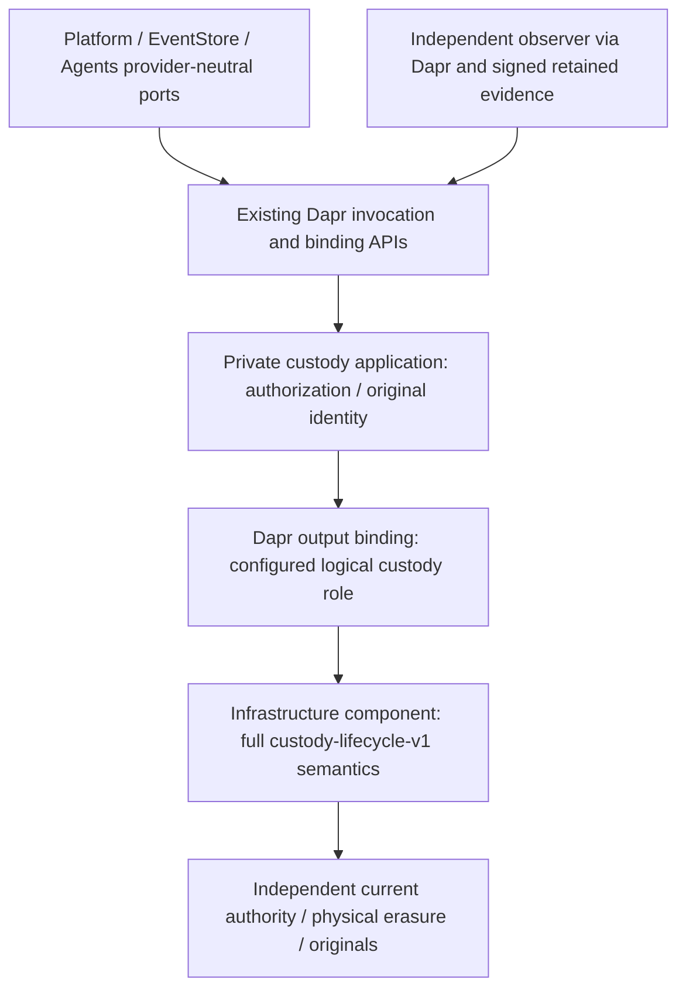

# EXT-SECRETS-1: Dapr custody and surviving erasure authority

2026-10-20 • Platform/security/operations owners and Agents Story 5.4 implementers • reviewed source `ad1c770d680f70af3a9638306635ba514426ef36`.

**Architecture approved subject to the owner's subsequent Dapr-only constraint. Physical feasibility, implementation and qualification remain incomplete. EXT-SECRETS-1 remains Committed and unavailable.**

## Adopted decision and approval boundary

Use a **hexagonal custody boundary with a recoverable state machine**, accessed exclusively through Dapr. For this custody feature, Platform, EventStore, Agents and custody application services retain provider-neutral contracts and existing Dapr SDKs. They acquire no cloud SDK, native database client, provider endpoint/ARN, provider-specific request type or infrastructure credential dependency. Component configuration selects infrastructure; switching providers changes configuration/component deployment, not application source or shared contracts.

The owner first said “I approve”, then clarified: **“we must keep infrastructure abstraction given by DAPR, any infrastructure dependency should be avoided.”** The latter instruction controls adoption. The earlier direct AWS adapter, mandatory AWS deployment and proposed Platform AD-9 exception are **not adopted**. No exception was added to the parent spine. The AWS epoch/DynamoDB/S3 design is retained as a reference feasibility profile inside an infrastructure component, not a Platform dependency or approved deployment. [Approval scope and frozen basis](ext-secrets-1-erasure-authority-2026-10-20/OWNER-APPROVAL.md).

OA-1 accepts the recoverable **shared physical cut** criterion: native current-state reservation/arm, one irreversible cut for the complete target set, then recoverable original receipt publication. A single transaction spanning independent storage and key services is not asserted. All-or-none target decryptability, correct holds, survivor recovery, exact originals and no early terminal result remain mandatory. If the Dapr component/provider cannot prove those properties, reject it. Approval does not turn an unsupported primitive into a guarantee.

Adopt a provider-neutral semantic custody **Dapr output-binding contract** `custody-lifecycle-v1`. Prefer a supported existing component if one qualifies; none providing the complete contract was identified. The concrete fallback is a new pluggable output component, proposed type `bindings.hexalithcustody`, component API `v1`, implementing the full lifecycle/authority semantics below. It is **not installed, certified or qualified**. It adds a missing capability rather than wrapping an existing native exception with a thin HTTP relay. Dapr secret/state/crypto calls alone are not this provider.

The [spine](../../_bmad-output/planning-artifacts/architecture/architecture-ext-protection-1-custody-2026-10-18/ARCHITECTURE-SPINE.md) preserves AD-16–AD-24 and adds AD-25 for the mandatory Dapr boundary. The [implementation spec](../../_bmad-output/specs/spec-ext-secrets-1-interaction-custody/SPEC.md) adopts this decision; its immediate work is bounded offline feasibility, not infrastructure deployment.

## Approval disposition and remaining evidence

| Item | Current owner decision | Still required |
| --- | --- | --- |
| OA-1 | Shared-cut/recoverable-outcome criterion adopted; no native cross-service transaction claim | Model and native Dapr/provider proof of all-or-none target erasure, exact originals and safe failure cuts. |
| OA-2 | Independent custody deployment/recovery classes retained; all infrastructure access through Dapr. Direct cloud adapter/AD-9 exception and mandatory AWS accounts/Region superseded | Qualifying component/provider choice, actual independent deployment and public scope/trust references. No infrastructure provisioning authorized. |
| OA-3 | Accept one physical cycle per tenant, whole-tenant preparation pause/O(N) survivor sweep, existing actor bounds and fail-closed authority loss; seven-plus-day pending erasure acceptable for the retained reference profile | Declared actual provider latency/rates/budget/capacity/retention and measured finite admission/completion capacity. No fixed completion SLA or automatic authority replacement. |
| OA-4 | Registered-system-copy/vendor-assurance/trusted-runtime boundary adopted | Actual provider assurance, every copy/key lineage and Dapr/SDK/component/transport buffer cleanup or accepted termination proof. Nothing waived by approval. |
| OA-5 | Original hierarchy, guard/current-authority, native-intent and key-use completion semantics adopted, now behind Dapr | Freeze binding byte vectors, component operation authentication, Dapr duplication/timeout/message/buffer tests, implemented ports and physical proofs. |
| OA-6 | Finite retention/extension/minimization must cover every referenced batch/outcome/backup; allocation exclusions/public verification remain | Actual lock/retention settings and extension margins. No numeric TTL invented and no live reference expires early. |

Unchanged scope: no infrastructure deployment, destructive qualification, owner Live/cohort run, Agents register amendment or Available declaration. Exact synthetic resources, monetary ceiling, ownership/cleanup and retained originals need separate authorization before native experiments.

## Verified evidence and Dapr capabilities

[HANDOFF.md](/home/administrator/hexalith-secrets-evidence/ext-secrets-1/completion-20261019/HANDOFF.md), [INPUTS.md](ext-secrets-1-completion-2026-10-19/INPUTS.md), existing custody interfaces and Agents EXT-SECRETS-1/EXT-PROTECTION-1/v21/v23/OQ-5.4-1 remain authoritative inputs. [Source bindings](ext-secrets-1-erasure-authority-2026-10-20/source-bindings.json) distinguish the reviewed candidate and inspected sibling revisions; neither architecture approval nor a new spec changes the accepted register target.

Retained real OpenBao/Raft recovery **revived deleted key material**. A new mount, restored tombstone or Dapr wrapper around that same provider does not repair it. [Negative-control evidence](ext-secrets-1-option-a-feasibility-2026-10-18/README.md). Metadata observation found one Kubernetes node, local OpenEBS Delete/Retain classes, OpenBao 2.6.2 with three ready replicas and Dapr 1.18.1; replicas on one host establish no independent host/site survival. [Observation](ext-secrets-1-erasure-authority-2026-10-20/infrastructure-observation.json). No fresh infrastructure/secret read or physical operation was needed for this adoption.

Dapr output bindings support component-specific operations and payload/metadata; pluggable bindings implement gRPC Init/Invoke/ListOperations/Ping over a Unix domain socket. This is a supported extension surface, **not proof that a custody implementation exists**. [Binding API](https://docs.dapr.io/reference/api/bindings_api/), [pluggable implementation](https://docs.dapr.io/developing-applications/develop-components/pluggable-components/develop-pluggable/), [registration](https://docs.dapr.io/operations/components/pluggable-components-registration/). The exact runtime-tag binding proto is retained with [Dapr research](ext-secrets-1-erasure-authority-2026-10-20/dapr-boundary-research.json).

The listed Dapr crypto components perform cryptography; they do not expose the complete atomic manifest/hold/nonrollback/original-result lifecycle. No qualifying built-in provider was established. Do not substitute the Dapr Crypto Scheme for existing AES-GCM root AAD/envelopes. [Crypto component inventory](https://docs.dapr.io/reference/components-reference/supported-cryptography/), [crypto overview](https://docs.dapr.io/developing-applications/building-blocks/cryptography/cryptography-overview/).

## Exact stack and infrastructure isolation

| Boundary | Version/contract | Status |
| --- | --- | --- |
| Dapr runtime | `1.18.1` | Observed installation; exact future runtime/image still pinned at qualification. |
| Existing Dapr.Client / Dapr.Actors | `1.18.10` from current Builds catalog | Reuse existing application dependencies; no vendor SDK added. |
| Source SDK / candidate runtime | `10.0.402` / `10.0.13` | Existing reality-checked baseline; no new compiled service/image claimed. |
| Dapr binding APIs | HTTP `/v1.0/bindings/<configured-name>` or corresponding gRPC API; component gRPC `dapr.proto.components.v1.OutputBinding` | Existing supported transport; application uses existing SDK/shared wrapper. |
| Semantic custody binding | `custody-lifecycle-v1`; proposed `bindings.hexalithcustody`, component API `v1` | New infrastructure component, not a built-in/installed product. Implementation/artifact/proof absent. |
| Existing HMAC component | OpenBao `2.6.2`, Dapr `secretstores.hashicorp.vault` | Existing purpose/scope unchanged; never promoted to erasure authority. |

No preview .NET pluggable-component SDK is required by this architecture: the infrastructure implementation may generate the pinned gRPC protocol. Its implementation dependencies and immutable artifact belong to the component, never to Platform/custody application project references. The previous AWSSDK versions remain historical feasibility research only. No database/cloud/Region is a required application stack row.

**New deployment requirement:** independently governed custody component/provider authority outside the application cluster's restore/failure domain, plus independently retained original evidence and public trust. Colocating its UDS-facing process with a sidecar does not make its backing authority independent. Actual host/zone/site/provider identities must establish that property; three local pods are insufficient. Ordinary restores cannot recreate that authority from app state.

**New recovery classes:** `interaction-custody-authority-v1` (forward-only current head), `interaction-custody-envelopes-v1` (gated encrypted copies) and `interaction-custody-originals-v1` (retained outcomes/public trust). These are inventory/recovery classes, not Kubernetes StorageClass objects. Provider settings/credentials stay in independently governed Dapr component configuration/secret references. No credentials or native IDs cross into application configuration/events; application StoreTarget is an opaque enrolled custody identity.

The observer uses a separately enrolled read-only Dapr service/component role and independent public trust, never the physical provider's self-reporting signer as its own authority. It gains no application-native infrastructure bypass: its runtime access uses Dapr too. Provider/operator evidence may be collected by independently authorized infrastructure tooling, not application paths.

## Dapr contract, retries and authentication

### Operations and current authority

Resolve the binding name once from the declared logical role `interaction-custody`; never hardcode its physical name/type. The semantic operation allowlist is `wrap`, `unwrap`, `pin`, `unpin`, `destroy-manifest`, `lookup-original`, `read-current`, `admit-transition`, `record-transition`, `recover-transition`, `verify-transition`, `lookup-transition`, `read-original-page`, `complete-key-use`. Per-key interaction Destroy delegates to the exact original complete manifest; no independent key-delete operation bypasses it.

Requests carry closed ProtocolVersion, authenticated tenant/owner-purpose scope, original OperationId/RequestDigest, expected authority revision and authenticated exact private operation/control proof. Key operations carry complete existing Identity, manifests carry the complete original owner reservation/vector, and anchor operations carry existing AnchoredStateTransition scope; no invented key identity substitutes for a whole manifest or anchor. The binding name, app ID, caller metadata, tenant string or Dapr mTLS identity alone grants no lifecycle authority. Restrict component scopes to the enrolled custody application, enforce app-channel/caller authentication and retain independently current exact authorization. Component/provider credentials are inaccessible to application DI, callers, Workflow and public handlers. Value-free responses preserve current DTOs, statuses and ordered original bytes. Key-bearing delivery follows the distinct lease rule below; key results are never persisted. Application code verifies provider evidence through a versioned, provider-neutral signed claim profile without parsing cloud-native evidence with a cloud SDK.

`read-current` is outside immutable-original response replay: every invocation performs a fresh linearizable current-authority read, even after transport duplication. Bind its authenticated proof to a fresh, non-reused caller RequestAttemptId/challenge, authority incarnation and observed revision/digest, within the current call's accepted deadline. Never answer from lookup-original, a cached signed head or a historical receipt. A fresh proof does not lock authority; each new key release/effect admission still consumes current permission and native expected-revision comparison at its effect boundary.

Protect the component UDS with socket ownership/ACL and volume mounts limited to daprd and the infrastructure component; the application container has no socket mount/access. gRPC OutputBinding carries no inherently authenticated original caller field, so scopes do not replace exact signed/private operation proofs. Enable the required gRPC reflection and pinned imported protos, and match socket discovery/type registration to component configuration. Init binds the enrolled opaque authority/store/incarnation and public configuration/trust digest. Same-profile re-registration never clears originals/native intents/holder uncertainty. Reject changed identity/profile/trust through Init; supported current trust/credential rotation uses separately authorized forward transitions, never implicit authority rollover.

Application code never orchestrates state/crypto/object-storage components to simulate one destructive transaction. The semantic custody component owns current heads, physical pins, full manifest ownership, destructive intent recovery and originals as one qualified provider protocol. A thin pass-through binding with no such guarantees is unavailable.

### Retries, key delivery and anchor transitions

Dapr/SDK/proxy/component retries can duplicate or outlive a call. Disable configured automatic retries for destructive/key-copy paths and verify actual effective runtime/component defaults; retries are not an exactly-once guarantee. Even with zero configured retries, exact duplicate Execute can arrive: the component admits the permanent original once and subsequent duplicates perform lookup only. A timeout/cancellation/lost acknowledgement returns Unknown. Lookup starts no physical effect; the provider's separately authorized durable worker may finish its already admitted original. [Dapr retry policies](https://docs.dapr.io/operations/resiliency/policies/retries/retries-overview/).

Separate immutable **value-free** originals from ephemeral key delivery. Wrap retries return the original opaque registration, never persisted D/X/K bytes. Each unwrap/key-use delivery requires current exact recipient-process and Dapr transport-incarnation enrollment plus its own admitted KeyUseLeaseId/DeliveryAttemptId, registered before any key leaves the component. Commit one release attempt before sending; duplicate/lookup after release admission returns status/proof only, not cached key bytes. An uncertain delivery remains an outstanding holder until every participant's I/O/buffers are reconciled. Closed/frozen/erased leases never emit keys. A later legitimate use requires a fresh currently authorized lease for the same original root, not root or destructive-identity recreation. Disable transport retries, but still assume delayed duplicate messages exist; every actual key-bearing delivery/transport copy must join the exact lease inventory. Persisting a raw response to obtain byte-identical retry is forbidden. If unchanged ports plus the actual Dapr transport cannot meet these rules, F1 rejects that path rather than adding a native bypass.

Anchor operations preserve the inherited four distinct phases: admit durably retains exact permitted transition without anchor advance; record conditionally advances the exact predecessor anchor; recover is a separately authorized same-admitted-original anchor mutation with no physical effect replay; verify/lookup are fresh authenticated reads without advancement. Bind existing complete owner/purpose/predecessor/target revisions/digests and exact admitted bytes. Neither admit nor lookup can substitute for record/recover.

### Message limits and original-result reads

The pinned Dapr 1.18.1 pluggable gRPC client has a default **4 MiB response ceiling** without a verified deployment override. Do not promise that a configuration value raises every hop's limit. Return a bounded authenticated header for each complete value-free manifest result. The header contains its immutable OriginalResultReference, RequestDigest/reservation/manifest binding, total byte length/target count and SHA-256 of the exact retained result. `read-original-page` returns at most 256 KiB of those original bytes per page, with offset/length/page digest and the same header identity; the complete wire frame must remain below 1 MiB. Authenticate every read and reject holes/overlap/substitution/hash mismatch. Assemble and verify the entire original vector/signature before returning public Consumed; timeouts retain Unknown and lookup resumes reads. Paging immutable receipt bytes is not target batching: B1–B5 still owns one full manifest, one physical cut and one terminal vector. Never page raw key delivery.

For input, preserve the entire 1,000-target request as one semantic invocation. F1 must measure its worst legal encoding and prove supported limits at SDK→sidecar→component server, including imported proto/reflection/socket registration. No unverified setting or partial target admission is allowed. If the pinned transport cannot carry the full request, stop and require a separately approved supported runtime/component revision; do not truncate, silently tighten public field limits or split manifest consumption. Existing operation deadlines still bound assembly/recovery. Never replace the manifest with target loops. Sidecar restart/upgrades, UDS re-registration, unavailable component and ambiguous transport response fail closed. A successful Dapr binding response is not an irreversible receipt without independent physical proof.

### Key-buffer closure

Owned key buffers required by existing key-provider ports extend the holder inventory to Dapr SDK/sidecar/UDS/gRPC/component/TLS buffers and diagnostics. No API/schema change is silently made to avoid this obligation. Disable request/body logging, traces containing content/keys and memory capture; obtain real completion/zeroing or accepted termination proof. If the exact transport cannot establish required erasure closure, the provider remains unqualified. Merely placing raw keys behind Dapr does not prove their erasure.

## Stable hierarchy and shared physical cut

Keep original 32-byte interaction root D and existing tenant KEK K(t,v), original KekVersion/AAD/opaque reference. Existing `CustodyKeyWrapCore` produces C0. Persist C0 only inside outer AES-GCM-X(C0), with random per-target X protected by tenant erasure epoch E(t,g). Tenant KEK protection R(t) and E are distinct; actual key/service IDs remain component-private. Historical K/R cannot reach C0 without X. Persist no bare C0, X, D or K. An old ungated wrapper backup requires separate closure; adding a layer today cannot repair it.

Before one manifest M destroys E(g), freeze whole-tenant allocation/copy/write/key-acquisition, drain all prior holders/producers, and move only non-target X to one independently verified successor E(g+1). Never move selected X into a surviving path. Before arm require actual permanent deletion evidence for every **other** predecessor/abandoned/tainted epoch receiving X. The current source E(g) must remain live until the B4 cut; the exact adopted successor remains live for survivors. Those two are the only live exceptions, and selected targets may have a path only through E(g). Unknown copy closure blocks arm. At arm atomically adopt the successor as current and resume only survivor/new-root admission under it. Targets remain fenced. Routine KEK/signing rotation neither recreates roots nor changes original AAD.

The sole remaining epoch deletion is the common physical cut. This conditional inference still needs native proof behind the Dapr component. The retained standard generated single-Region KMS profile documents an irreversible deletion endpoint, but its APIs, SDKs, table/object layouts and seven-day scheduling are **reference provider details**, not mandatory app dependencies or qualified Dapr operations. Ordinary Raft restore remains rejected regardless of abstraction.

Permanent allocation excludes new roots for the original interaction as well as full tenant/interaction/alias target. Unknown unpublished generation burns the identity rather than issuing a replacement; unwrap/absence/restore never generates a root. Preserve unknown generation/copy attempts and original key-use completion throughout recovery.

## Transaction boundaries and original recovery

| Boundary | Component-owned guarantee | Failure rule |
| --- | --- | --- |
| B0 protection reserve | Existing EventStore owner orders block/ConsumptionReserved and produces exact original reservation | Custody never replaces batch/capability/reservation. |
| B1 custody reserve | One linearizable current-head transition authenticates complete vector/digest/revisions, hold/control proof and B0; freezes entire tenant preparation admission | Reject effective/unknown pins; admitted uncertainty is Unknown, not NotStarted. |
| B2 preparation | Drain pre-freeze native intents/holders; complete independent survivor checkpoint; actual retirement of every alternate epoch | Partial preparation resumes only under original M; no terminal result. |
| B3 arm | Conditional current-head transition validates closure and adopts exact successor as current epoch | Intervening hold/unpin/revocation mutations invalidate stale comparisons. |
| B4 physical cut | Qualified provider destroys one sole remaining epoch for all selected targets | Scheduling/disablement/missing-key/auth refusal/outage is insufficient. |
| B5 publication | Independently verify all-copy/holder closure, successful survivor recovery and restore barrier; publish one immutable original ordered vector | Merge with current state without rewinding survivors; recover exact selected bytes/signature. |

Prewrite/verify complete immutable canonical checkpoint/request/receipt objects before one conditional head/index commit. Keep vectors outside provider item/action limits; validate an entire manifest at one head revision, never target chunks. Provider limits are deployment/profile facts tested by the component conformance suite. Keep permanent operation/event/allocation indexes and exact receipt/signature bytes without premature TTL.

Normalized native intent retains original ID/digest, producer incarnation, opaque source/destination generations and phase `Prepared → SendCommitted → ResultDurable → Closed`; lost send remains Unknown and is never resent after restart. B3 needs actual producer/I/O/buffer drain or accepted termination evidence. Unknown staging-copy destination becomes tainted and cannot be adopted; permanently destroy it before any arm. An unknown current/adopted destination disqualifies safe completion. Dapr sidecar delivery attempts join this identity/drain model; a replaced sidecar or revoked credential does not close its old I/O automatically.

Keep NotStarted/Consumed/Unknown and lifecycle statuses unchanged. Only authoritative exact absence with no uncertain admission yields NotStarted. Consumed/Destroyed requires full original vector/RestoreBarrierReceiptId. Caller lookup is authenticated read-only. Entirely covered targets need no physical effect; mixed covered/live manifests require the existing authenticated original-coverage/residual protocol or refusal, never edited signed membership. The actor's 30-second deadline remains a bounded request budget, not days of physical waiting.

## Hold, revocation, copy and restore invariants

Guard hold registration precedes physical pin grants; guard dispatch orders later governance holds. EventStore ConsumptionReserved remains the sole post-dispatch cancellation/compromise instant. Custody arm is separate. Earlier effective/unknown pins block both per-key and manifest effects. Later post-dispatch holds cannot receive a conflicting successful Pinned outcome, including before custody receives the owner reservation; they remain restrictive elsewhere. Native head comparisons serialize pin/unpin/reserve, and unpin consumes only the same authorized hold release. Preserve v23 replacement-key block-set expected revisions, private revocation and sole active attestation.

Preserve accepted timing 300/30/600/86400/604800, integration date 2026-10-08, host 192.168.1.30, non-expiring revocable capability and independently held decision-approval signing keys. Overlapping-export policy stays **Open**. No export/history policy is inferred.

| Copy/recovery class | Closure required before terminal result |
| --- | --- |
| Source outbox, target events, snapshots, caches/read models, brokers/DLQs, Workflow/Dapr state, temp files and backups | Same original interaction root and complete occurrence inventory; no independent plaintext/DEK path. |
| Separately encrypted exports/partial outputs/manifests/indexes/export-key wraps/backups | Independent decrypting paths need their own accepted lifecycle closure. Open/unqualified policy blocks affected targets; export-free branches may proceed. |
| Encrypted key/checkpoint/object versions, replicas/logs/PITR/backups/restored clones | Every historical/current/abandoned key generation/copy mapped; no bare C0 or key bytes. Restored metadata cannot become current. |
| Dapr sidecar/component/SDK/UDS/gRPC/TLS/process memory and late requests | Owned key-use/native-intent completion or accepted isolation/termination evidence; no swap/core/hibernation/memory snapshots/body logging. Timeout/lease expiry is not zeroing. |
| Physical key-service internal copies and operator/recovery paths | Accepted provider assurance and no direct bypass around semantic custody. Permission/policy drift invalidates closure. |
| Originals, public anchors and restore evidence | Independent encryption/retention through every referenced batch/backup lifetime, not encrypted solely under erased E. |

Register actual owner/location/retention/lineage/holder/incarnation and exact copy outcome before effect. Unknown inventory blocks terminal receipts. Approval covers registered system copies and a surviving independent authority, not previously exfiltrated plaintext or total compromise of all custodians/provider.

Restart/app restore uses the same surviving current authority via Dapr, initial opaque AuthorityEnrollmentV1 identity/incarnation/public trust and current revocation outside the restored set. Reconcile exact admitted actor transitions through inherited anchored authority. Verify terminal restore barrier before typed Erased; missing keys never suffice. Provider-native table/key identities stay inside enrolled component configuration/evidence, not application contracts. First-release authority replacement/incarnation rollover is unsupported: loss fails closed, with no bootstrap from backup or self-enrollment of restored clones.

First release keeps 1,000 admitted registrations/10,000 retained lifecycle requests per tenant projection, no automatic archive/shard/eviction. Reserve completion capacity before admission and retain originals/allocation exclusions permanently for their required lifetime. Native-provider/Dapr-buffer/per-original headroom needs measurement; inability to fit blocks implementation rather than silently raising limits.

## Bounded feasibility, provisioning and acceptance

These stages are planned, not executed. No application vendor SDK or bypass is permitted even in a prototype claimed as compliant. Isolated component-internal provider testing can use vendor tooling under separate authorization; it cannot substitute for an end-to-end Dapr path.

| Stage | Bound | Acceptance/stop |
| --- | --- | --- |
| F0 offline copy/protocol model | 2 engineering days; bounded small-state exploration plus 1/1,000 vectors, no network/credentials/key bytes | Every B0–B5 crash/loss/restore/hold/reissue/late-copy cut preserves all-or-none targets, recoverable controls and one original. Model Dapr duplicates, sidecar loss and unacknowledged buffers. Retain counterexamples; no physical claim. |
| F1 Dapr component/contract feasibility | 2 days, no provision | Verify pinned output-binding transport, full semantic component capability, maximum byte vectors/response limits, private authorization, no app-native packages/endpoints, effective retries and actual buffer-lifetime proof strategy. Stop if no component/provider can meet physical/current-authority semantics; a binding stub is not success. |
| F2/F3 separately authorized provider plus Dapr faults | 6 active days plus true provider destruction wait; one joint original schedule, not repeated destruction | Two synthetic tenants: small same-tenant held/survivor lane and separate 1,000-target lane. Exact resource/monetary ceiling first; optional historical AWS profile cap remains five total epochs incl one tainted candidate, two KEK protectors, one authority store, two archive stores, two control instances. Run actual component/provider effects and Dapr invocation path, sidecar/component restarts, delayed/duplicate Execute, lost lookup/results, message-limit and key-buffer faults. Old backups/config/keys/receipts cannot decrypt targets; controls recover independently. Distinguish cryptographic erasure from gateway denial. |

Ten active engineering days total; actual destruction/evidence wait is additional and not a fixed SLA. After 15 business days from approved native start without final proof, retain Blocked/Unknown and seek scoped continuation. Additional candidate/cycle/resources require separate authorization; no cap or identity/journal reset. Preserve original native evidence and independently verify cleanup.

Provisioning returns **Dapr logical component/service roles**, exact runtime/component artifact versions, provider-neutral authority/store/profile identities, independently retained public anchors, current scope/authentication proofs, complete copy/restore/original references and declared operational/retention bounds. Vendor resource configuration/credentials belong only to the infrastructure component owner. Actual provider artifact, physical backend and installation are still absent; do not fill operator fields with proposed strings.

Production binding requires component/provider conformance and all physical/copy/holder/restore proofs, real six-operation/batch/occurrence adapters and independent observers, plus every other EXT-SECRETS-1 input and accepted OQ-5.4-1 shared target/profile/runner. No current register command/plan/hash/status is amended. Documentation approval, a successful Dapr call or component-model pass establishes no Available state.

## Assurance classification

Verified: reviewed interfaces/negative control, retained selected infrastructure metadata, Dapr output-binding extension protocol and documented APIs. Existing source/runtime pins are observations, not a new service build.

Adopted: Dapr-only dependency direction, provider-neutral semantic binding, original root/hierarchy, shared-cut criterion, ordering/recovery/copy/retention invariants and conditional failure envelope. Provider-specific infrastructure remains isolated in replaceable component configuration and implementation.

Unproved: a qualifying implemented Dapr custody component/provider, physical erasure/independent authority, all-copy and sidecar/transport/host memory closure, current cross-owner handoff, SDK/artifact compatibility and native end-to-end original recovery. These remain explicit feasibility/installation/qualification blockers; no direct infrastructure exception may bypass them.
